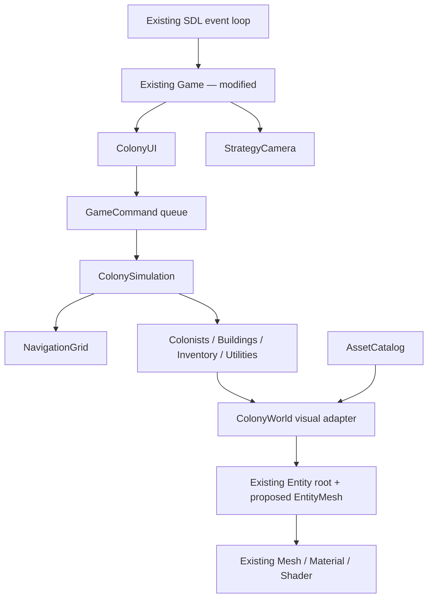

# ARKFALL: MVP Implementation Plan

**Planning date:** 8 November 2026  
**Project:** `repo_compartido/TJE_Framework`  
**Status:** revised technical implementation plan based on the supplied design documents, theory references and inspected framework source. P01, P02 and P03 are implemented (P03 results in [P03_navigation_report.md](P03_navigation_report.md)); the pre-P03 corrections of 24 November 2026 are recorded in [P02_asset_report.md](P02_asset_report.md) and in sections C5, C9 and P03 below.

The recommended implementation is a **single-map colony simulation using the existing SDL/OpenGL framework, a 1 m planar navigation grid, autonomous colonist state machines, and JSON-driven scene, scenario, asset, building, colonist and material definitions**.

The framework supplies rendering and resource primitives. The colony simulation, construction, utility calculations, navigation integration, selection, and UI must be built.

No game source was changed during the investigation. Compilation and gameplay were not executed. The validation procedures below are implementation tasks, not completed tests.

## Reading conventions

- **Verified:** observed in the supplied files.
- **Proposed:** a new design, contract, file, parameter, or behavior recommended by this plan.
- **Provisional:** a proposed interpretation of incomplete or conflicting requirements that should be confirmed before tuning is frozen.
- PDF references use physical page numbers, starting at 1.
- Source paths are relative to the repository root unless stated otherwise. Proposed implementation files are rooted in `TJE_Framework/`.
- All new classes and contracts below are proposals unless explicitly identified as existing.

## A. Sources Reviewed and Diagnosis

### A1. Source inventory

| Reference | Source and inspection |
|---|---|
| **MVP** | [ARKFALL — MVP Scope](ARKFALL%20%E2%80%94%20MVP%20Scope.pdf): both pages read; scope table and phased extras inspected visually. |
| **GDD** | [ARKFALL — Game Design Document](ARKFALL%20%E2%80%94%20Game%20Design%20Document.pdf): all 11 pages read; core-loop diagram on p. 7 and visual references on pp. 10–11 inspected. |
| **T05** | [Game and Level Design](Theory/5%20-%20Game%20and%20Level%20Design.pdf): 44 pages; pillars, core loop, pacing, prototyping and playtesting. |
| **T06** | [Writing a GDD](Theory/6%20%20-%20Writing%20a%20GDD.pdf): 10 pages; design-document requirements. |
| **T07** | [Basics of CG](Theory/7%20-%20Basics%20of%20CG.pdf): 44 pages; rendering, transforms, shaders, textures and blending. |
| **T08** | [Scene Representation](Theory/8%20-%20Scene%20Representation.pdf): 43 pages; entities, scene graphs, ownership, deferred destruction and scene export. |
| **T09** | [Render Optimization](Theory/9%20-%20Render%20Optimization.pdf): 24 pages; culling, batching, instancing and profiling. |
| **T10** | [World Rendering](Theory/10%20-%20World%20Rendering.pdf): 26 pages; grid environments, modular assets, terrain and sky. |
| **T11** | [Player Controller](Theory/11%20-%20Player%20Controller.pdf): 17 pages; controller/camera separation and indirect control. |
| **T12** | [3D Collisions](Theory/12%20-%203D%20Collisions.pdf): 35 pages; picking, bounding volumes and Coldet. |
| **T13** | [AI](Theory/13%20-%20AI.pdf): 32 pages; state machines and navigation. |
| **T14** | [Assets for Games](Theory/14%20-%20Assets%20for%20Games.pdf): 17 pages; asset integration and placeholders. |
| **T15** | [Physics](Theory/15%20-%20Physics.pdf): 19 pages; collision/physics distinction and simpler alternatives. |
| **T16** | [GUI and HUDs](Theory/16%20-%20GUI%20and%20HUDs.pdf): 19 pages; orthographic UI, input hit testing and render order. |
| **T17** | [Audio](Theory/17%20-%20Audio.pdf): 23 pages; BASS lifecycle and feedback. |
| **T18** | [3D Animations](Theory/18%20-%203D%20Animations.pdf): 43 pages; rigid animation, skinning and conversion workflow. |
| **T19** | [Final project: 3D Game](Theory/19%20-%20Final%20project_%203D%20Game.pdf): 26 pages; evaluation, completeness, deployment and submission. |
| **T20** | [Improving Graphics](Theory/20%20-%20Improving%20Graphics.pdf): 44 pages; lighting, fog, post-processing and visual styles. |
| **T21** | [Particles System](Theory/21%20-%20Particles%20System.pdf): 18 pages; emitters, particle storage and rendering. |
| **T22** | [Beyond EG](Theory/22%20-%20Beyond%20EG.pdf): 21 pages; maintainability, iteration and scope. |

All theory pages were text-extracted and visually surveyed through rendered contact sheets. Relevant project tables and the GDD core-loop diagram were additionally inspected at larger resolution.

Other inspected material:

- [Framework README](../TJE_Framework/README.md), [CMake configuration](../TJE_Framework/CMakeLists.txt), application entry point and game lifecycle.
- Entity, camera, input, mesh, material, texture, shader, audio and animation code.
- Included pathfinding interfaces and implementations.
- Existing [SceneParser header](../TJE_Framework/src/game/scene_parser.h) and [implementation](../TJE_Framework/src/game/scene_parser.cpp), plus the ZIP inventory.
- [Blender scene exporter](../TJE_Framework/data/scene_exporter.py).
- [Kenney license](../assests/License.txt), preview, asset directory inventory, OBJ/MTL structure and GLB animation metadata.
- Existing build-cache locations and Git status.

**Inspection limits:** external videos and linked websites were not watched or opened. FBX, DAE and STL variants were inventoried but not imported into an editor. No asset was rendered through the game, so loader compatibility is established by static inspection, not a completed runtime test.

### A2. Current project behavior

The current application:

1. Initializes SDL and creates an OpenGL window/context.
2. Initializes `Input`.
3. Allocates `Game`.
4. Processes SDL events.
5. Calls `Game::update(double)` and `Game::render()`.
6. Displays a rotating textured box, floor grid and GPU statistics.

There is no implemented ARKFALL gameplay.

| Existing implementation | Verified behavior |
|---|---|
| `TJE_Framework/src/main.cpp:85`, `mainLoop()` | Input update, event dispatch, elapsed-time calculation, update and render. |
| `TJE_Framework/src/game/game.cpp:20`, `Game::Game` | Creates camera and loads example resources. |
| `TJE_Framework/src/game/game.cpp:57`, `Game::render` | Clears buffers, sets uniforms, renders and swaps the window. |
| `TJE_Framework/src/framework/entities/entity.cpp:51`, `Entity::getGlobalMatrix` | Uses `model * parent->getGlobalMatrix()`. Preserve this convention. |
| `TJE_Framework/CMakeLists.txt:71–78` | Collects sources from explicitly listed directories, including `src/game`. |
| `TJE_Framework/CMakeLists.txt:136–137` | Requires **C++20**. |

The existing top-level build cache points to an older source location without `repo_compartido`. The nested `build/codex_verify` cache points to the current location. Neither cache proves the current sources compile.

### A3. Framework capability assessment

| Area | Exists | Required work |
|---|---|---|
| Rendering | Meshes, shaders, textures, FBOs, instancing and GPU statistics | Scene rendering adapter, selection/construction visuals, material-compatible shader. |
| Scene representation | `Entity`, parent/children, transforms and traversal | A renderable entity class and explicit ownership policy. |
| Camera | Perspective/orthographic cameras, `lookAt`, projection, ray generation and frustum tests | Strategy camera controller. |
| Input | Keyboard/mouse states, SDL callbacks | Command routing, UI consumption, camera bindings. |
| Collision | `Mesh::testRayCollision`, `testSphereCollision`, Coldet | World picking; construction occupancy and navigation obstacles. |
| Physics | No integrated gameplay physics world found | Kinematic planar movement is sufficient. |
| AI/navigation | Graph-based A*/Dijkstra utilities | A dependable grid navigation layer and colony task logic. |
| Animation | `Skeleton`, `Animation`, `Animator`, skinned rendering | No compatible character animation assets supplied. |
| Audio | BASS wrapper: `Audio::Init`, `Play`, `Stop`, `Destroy` | Initialization, event feedback, audio assets and cleanup corrections. |
| UI | `drawText`, mesh primitives and orthographic camera | Buttons, panels, bars, hit testing and responsive layout. |
| Resources | Static mesh/texture/shader caches | Asset catalog, startup validation and application shutdown. |

Important differences from the slides and current source:

- **`EntityMesh` does not exist** in the supplied entity implementation.
- The parser in `TJE_Framework/src/game` calls **`SceneParser::parse`**, whereas T08 p. 40 illustrates `parseScene`.
- CMake explicitly collects `src/game`; the parser is in the build source set. It currently references a not-yet-defined `EntityMesh` and unfinished tagged-entity logic. P02 must either complete and use it or replace it deliberately; this plan chooses to complete it for the MVP scene file.
- T12 p. 28 describes `Collision` and `EntityCollider`; those classes are absent here.
- T13 p. 21 illustrates `AStarFindPathNoTieDiag`; that function is absent.
- The actual quad contract is `Mesh::createQuad(float center_x, float center_y, float w, float h, bool flip_uvs)`.
- Mesh binary caching uses **`.mbin`** in `Mesh::Get`; do not assume the animation slides' `.wbin` naming.

### A4. Existing code risks

**Navigation:** the included A* implementation sorts `open`, selects its first element, then uses heap removal on the sorted container. This deserves correction and focused testing before reuse. Searches also require explicit state cleanup; `PathFinder::findPath` does not clear previous output or algorithm state.

**Recommendation:** implement a small four-neighbor BFS grid for the MVP. Its edges have equal cost, so BFS gives shortest routes and nearest reachable jobs. This avoids repairing a generic graph library on the critical path. T13 pp. 18–21 and 31 support planar navigation for a flat world.

**Resource lifetime:** `Entity`'s destructor does not delete children. `Game` has no explicit destructor, and `main` never deletes it. The window-close event returns early from `mainLoop`, bypassing its trailing cleanup.

**Input:** `Input::mouse_wheel_delta` is assigned on wheel events but is not reset by `Input::update`. The current middle button toggles mouse locking; this conflicts with strategy-camera dragging.

**Materials:** `Mesh::render` uploads MTL `u_Kd`, `u_Ka`, `u_Ks` and `u_maps`. The sample fragment shader ignores these and always samples a texture.

**OBJ safety:** `MAX_SUBMESH_DRAW_CALLS` is 16. The supplied `alien.obj` has 18 material runs; the OBJ parser writes draw-call entries without a checked limit. Do not batch-load the entire pack.

**Scenario/data integration:** no JSON library or complete JSON data contract currently exists in the framework. The existing `TextParser` is not a JSON parser and is not safe to reuse for JSON. Add a pinned, vendored single-header JSON dependency and keep parsing/validation behind dedicated loaders.

Relevant verified symbols:

- `TJE_Framework/src/framework/extra/pathfinder/AStar.cpp`: `AStar::getPath`, `popOpen`, `clear`.
- `TJE_Framework/src/framework/extra/pathfinder/PathFinder.h`: `findPath`.
- `TJE_Framework/src/graphics/mesh.cpp:226`: `Mesh::render`.
- `TJE_Framework/src/graphics/mesh.cpp:1095`: `Mesh::parseMTL`.
- `TJE_Framework/src/graphics/mesh.cpp:1175`: `Mesh::loadOBJ`.
- `TJE_Framework/src/graphics/mesh.cpp:1720`: `Mesh::Get`.
- `TJE_Framework/src/framework/audio.cpp:54`: `Audio::Destroy`.

### A5. Asset inventory and integration

The actual asset directory is named **`assests`**. Preserve it as source material; copy only selected runtime assets into `data`.

| Content | Existing quantity/state |
|---|---|
| OBJ | 153 models, with 153 matching MTL files; referenced MTL files exist. |
| DAE, FBX, GLB, STL | 153 variants per format. |
| GLB animation metadata | All 153 checked: **zero skins and zero animation clips**. |
| PNG | 772 images, including previews and directional renders. |
| Archive | Kenney Space Kit ZIP, 1,702 entries. |
| Game animation assets | No game `.mesh`/`.skanim` character pipeline found. |
| Game audio | No ARKFALL-specific sound set found. |

The pack's local license states CC0. Retain its license in distribution.

Verified scale examples:

- `assests/Models/OBJ format/astronautA.obj`: Y range `0 … 0.7931839`.
- `assests/Models/OBJ format/terrain.obj`: flat XZ square, `−0.5 … +0.5`.
- `assests/Models/OBJ format/platform_large.obj`: width/depth 2, height 0.1.
- Selected models use MTL colors rather than a diffuse-texture atlas.

Use **Y-up, XZ navigation and meters as proposed world units**. Scaling the astronaut uniformly by approximately `2.269` gives a 1.8 m character. Semantic forward direction still needs an in-engine orientation check.

All source candidates below are under `assests/Models/OBJ format/`.

| Gameplay purpose | Existing source candidate | Work required |
|---|---|---|
| Colonist | `astronautA.obj` | Uniform scale; role tint; rigid movement initially. |
| Ground | `terrain.obj` or generated plane | Red palette and map boundary. |
| Interior floor | `platform_large.obj` | Modular arrangement without roof. |
| Exit Door | `gate_simple.obj` | Match visual doorway to navigation portal. |
| Storage | `barrels.obj` | Footprint and clear label. |
| Oxygenator | `machine_barrel.obj` | Label/color distinction. |
| Water Extractor | `machine_generator.obj` | Label/color distinction. |
| Iron/Copper/Aurite Processor | `machine_generatorLarge.obj` | Three colors and labels; shared geometry acceptable. |
| Iron/Copper deposit | `rock.obj`, `rock_crystals.obj` | Distinct material tint and deposit marker. |
| Mines | Rock + machine composition | Proposed composite placeholder. |
| Greenhouse | Platform + small machine composition | Proposed roofless placeholder; vegetation pending. |
| Solar Panel | Generated tilted rectangular panel | New simple geometry. |
| Landing Pad | Platform composition | New painted landing marker. |
| Haven Beacon | `machine_wireless.obj` + `satelliteDish_large.obj` | Proposed composite, visibly larger. |

These are mappings, not claims that the kit contains finished ARKFALL buildings.

### A5.1. Complete OBJ bounds and proposed scale factors

The source pack has 153 OBJ models. The table below measures the axis-aligned extents of every source OBJ model, in source coordinates and Y-up order (X × Y × Z). These raw values are not asserted to be physical metres; the plan maps them to metres by applying the proposed uniform scale. The proposed uniform scale is a visual starting point, not a gameplay footprint. Scale 1.00 deliberately preserves modular pieces, vehicles and decorative variants; small props are allowed to stay smaller than a 1 m cell. Where a model has a specific gameplay use, use its explicit target scale in the following table. Building footprints remain authoritative for occupancy.

The overrides make the building visuals fill roughly 80–85% of their 2×2 m logical footprint where the source model is a compact machine or storage cluster. They do not change the 1 m terrain cell, 2×2 m floor module, or 1 m Exit Door portal. Composite buildings apply component scales in their building visual definition so the same model can be used at different sizes without changing its source mesh.

| OBJ asset | Source dimensions X × Y × Z (source units) | Proposed uniform scale | Vertex count |
|---|---:|---:|---:|
| `alien.obj` | 0.4832 × 0.8432 × 0.33 | 2.135 | 156 |
| `astronautA.obj` | 0.4832 × 0.7932 × 0.33 | 2.269 | 158 |
| `astronautB.obj` | 0.4832 × 0.7932 × 0.33 | 2.269 | 167 |
| `barrel.obj` | 0.2 × 0.25 × 0.1732 | 3.2 | 30 |
| `barrels_rail.obj` | 0.55 × 0.35 × 0.4964 | 1 | 220 |
| `barrels.obj` | 0.55 × 0.35 × 0.4964 | 3.1 | 144 |
| `bones.obj` | 0.8614 × 0.4422 × 0.5821 | 1 | 96 |
| `chimney_detailed.obj` | 0.4 × 2 × 0.4 | 1 | 168 |
| `chimney.obj` | 0.4 × 2 × 0.4 | 1 | 72 |
| `corridor_corner.obj` | 1 × 1 × 1 | 1 | 57 |
| `corridor_cornerRound.obj` | 1 × 1 × 1 | 1 | 209 |
| `corridor_cornerRoundWindow.obj` | 1 × 1 × 1 | 1 | 244 |
| `corridor_cross.obj` | 1 × 1 × 1 | 1 | 84 |
| `corridor_detailed.obj` | 1.2 × 1.1 × 1 | 1 | 84 |
| `corridor_end.obj` | 1 × 1 × 0.5 | 1 | 62 |
| `corridor_open.obj` | 1 × 1 × 1 | 1 | 81 |
| `corridor_roof.obj` | 1 × 0.2414 × 1 | 1 | 24 |
| `corridor_split.obj` | 1 × 1 × 1 | 1 | 64 |
| `corridor_wall.obj` | 0.1 × 0.8 × 1 | 1 | 20 |
| `corridor_wallCorner.obj` | 1 × 0.8 × 1 | 1 | 130 |
| `corridor_window.obj` | 1 × 1 × 1 | 1 | 89 |
| `corridor_windowClosed.obj` | 1 × 1 × 1 | 1 | 97 |
| `corridor.obj` | 1 × 1 × 1 | 1 | 44 |
| `craft_cargoA.obj` | 1.6 × 0.8 × 2.45 | 1 | 134 |
| `craft_cargoB.obj` | 1.5 × 0.9 × 2.5 | 1 | 192 |
| `craft_miner.obj` | 1.8 × 0.7 × 2.6 | 1 | 194 |
| `craft_racer.obj` | 1.2 × 0.75 × 2.0257 | 1 | 142 |
| `craft_speederA.obj` | 2 × 0.8 × 2.1 | 1 | 142 |
| `craft_speederB.obj` | 2 × 0.6 × 2.0257 | 1 | 137 |
| `craft_speederC.obj` | 2.8 × 0.6 × 1.9257 | 1 | 148 |
| `craft_speederD.obj` | 2.8 × 0.9 × 2.2257 | 1 | 163 |
| `crater.obj` | 0.715 × 0.1176 × 0.8256 | 1 | 30 |
| `craterLarge.obj` | 0.886 × 0.12 × 0.886 | 1 | 32 |
| `desk_chair.obj` | 0.15 × 0.2938 × 0.15 | 2.72 | 46 |
| `desk_chairArms.obj` | 0.25 × 0.3438 × 0.15 | 2.33 | 66 |
| `desk_chairStool.obj` | 0.15 × 0.1688 × 0.15 | 2.67 | 40 |
| `desk_computer.obj` | 0.525 × 0.375 × 0.225 | 1.6 | 46 |
| `desk_computerCorner.obj` | 0.75 × 0.375 × 0.75 | 1.6 | 65 |
| `desk_computerScreen.obj` | 0.525 × 0.6375 × 0.225 | 1.25 | 54 |
| `gate_complex.obj` | 1 × 1.013 × 0.5 | 1 | 230 |
| `gate_simple.obj` | 1 × 1.08 × 0.5 | 1 | 106 |
| `hangar_largeA.obj` | 2 × 1 × 3 | 1 | 200 |
| `hangar_largeB.obj` | 2.2 × 1.1 × 3 | 1 | 180 |
| `hangar_roundA.obj` | 3.2712 × 1.5 × 2.833 | 1 | 85 |
| `hangar_roundB.obj` | 3.2712 × 1.8 × 2.833 | 1 | 85 |
| `hangar_roundGlass.obj` | 3.2712 × 1.4 × 2.833 | 1 | 56 |
| `hangar_smallA.obj` | 2 × 1 × 2 | 1 | 140 |
| `hangar_smallB.obj` | 2 × 1 × 2 | 1 | 142 |
| `machine_barrel.obj` | 0.6464 × 0.6 × 0.5155 | 2.6 | 168 |
| `machine_barrelLarge.obj` | 0.7543 × 0.6 × 0.7543 | 2.25 | 98 |
| `machine_generator.obj` | 0.7 × 0.4 × 0.525 | 2.4 | 208 |
| `machine_generatorLarge.obj` | 1 × 0.683 × 1.3 | 1.3 | 65 |
| `machine_wireless.obj` | 0.75 × 0.6 × 0.5 | 3 | 89 |
| `machine_wirelessCable.obj` | 0.75 × 0.8 × 0.6 | 3 | 146 |
| `meteor_detailed.obj` | 0.866 × 0.735 × 0.825 | 1 | 100 |
| `meteor_half.obj` | 0.866 × 0.3675 × 0.75 | 1 | 24 |
| `meteor.obj` | 0.866 × 0.735 × 0.75 | 1 | 36 |
| `monorail_trackCornerLarge.obj` | 1.6 × 0.13 × 1.6 | 1 | 104 |
| `monorail_trackCornerSmall.obj` | 0.6 × 0.13 × 0.6 | 1 | 104 |
| `monorail_trackSlope.obj` | 0.2 × 0.63 × 1 | 1 | 16 |
| `monorail_trackStraight.obj` | 0.2 × 0.13 × 1 | 1 | 16 |
| `monorail_trackSupport.obj` | 0.2 × 0.5 × 0.2 | 1 | 80 |
| `monorail_trackSupportCorner.obj` | 0.2 × 0.5 × 0.2 | 1 | 76 |
| `monorail_trainBox.obj` | 0.5 × 0.8 × 1 | 1 | 52 |
| `monorail_trainCargo.obj` | 0.5 × 0.64 × 1 | 1 | 408 |
| `monorail_trainEnd.obj` | 0.5 × 0.8 × 1 | 1 | 94 |
| `monorail_trainFlat.obj` | 0.5 × 0.25 × 1 | 1 | 44 |
| `monorail_trainFront.obj` | 0.6 × 0.8 × 1.05 | 1 | 121 |
| `monorail_trainPassenger.obj` | 0.5 × 0.8 × 1 | 1 | 84 |
| `pipe_corner.obj` | 0.8464 × 0.6 × 0.8464 | 1 | 42 |
| `pipe_cornerDiagonal.obj` | 0.8464 × 0.6 × 0.8464 | 1 | 24 |
| `pipe_cornerRound.obj` | 0.8464 × 0.6 × 0.8464 | 1 | 176 |
| `pipe_cornerRoundLarge.obj` | 1.8464 × 0.6 × 1.8464 | 1 | 178 |
| `pipe_cross.obj` | 1 × 0.6 × 1 | 1 | 96 |
| `pipe_end.obj` | 0.6928 × 0.6 × 1 | 1 | 41 |
| `pipe_entrance.obj` | 0.9238 × 0.8 × 0.6 | 1 | 63 |
| `pipe_open.obj` | 0.6928 × 0.6 × 1 | 1 | 50 |
| `pipe_rampLarge.obj` | 0.6928 × 1.2 × 2 | 1 | 80 |
| `pipe_rampSmall.obj` | 0.6928 × 0.9 × 2 | 1 | 80 |
| `pipe_ring.obj` | 0.9238 × 0.8 × 1 | 1 | 72 |
| `pipe_ringHigh.obj` | 0.9238 × 1.3 × 1 | 1 | 92 |
| `pipe_ringHighEnd.obj` | 0.9238 × 1.3 × 0.8 | 1 | 91 |
| `pipe_ringSupport.obj` | 0.9238 × 1.3 × 0.4 | 1 | 50 |
| `pipe_split.obj` | 1 × 0.6 × 0.8464 | 1 | 69 |
| `pipe_straight.obj` | 0.6928 × 0.6 × 1 | 1 | 40 |
| `pipe_supportHigh.obj` | 0.4 × 1 × 0.4 | 1 | 20 |
| `pipe_supportLow.obj` | 0.4 × 0.5 × 0.4 | 1 | 20 |
| `platform_center.obj` | 1 × 0 × 1 | 1 | 4 |
| `platform_corner.obj` | 1 × 0.1 × 1 | 1 | 42 |
| `platform_cornerOpen.obj` | 1 × 0.1 × 1 | 1 | 26 |
| `platform_cornerRound.obj` | 1 × 0.1 × 1 | 1 | 158 |
| `platform_end.obj` | 1 × 0.1 × 1 | 1 | 32 |
| `platform_high.obj` | 1 × 1 × 1 | 1 | 100 |
| `platform_large.obj` | 2 × 0.1 × 2 | 1 | 36 |
| `platform_long.obj` | 2 × 0.1 × 1 | 1 | 36 |
| `platform_low.obj` | 1 × 0.5 × 1 | 1 | 76 |
| `platform_side.obj` | 1 × 0.1 × 1 | 1 | 16 |
| `platform_small.obj` | 1 × 0.1 × 1 | 1 | 36 |
| `platform_smallDiagonal.obj` | 1 × 0.1 × 1 | 1 | 35 |
| `platform_straight.obj` | 1 × 0.1 × 1 | 1 | 28 |
| `rail_corner.obj` | 0.9 × 0.25 × 0.9 | 1 | 67 |
| `rail_end.obj` | 0.9 × 0.25 × 0.05 | 1 | 26 |
| `rail_middle.obj` | 1 × 0.25 × 0.05 | 1 | 24 |
| `rail.obj` | 0.8 × 0.25 × 0.05 | 1 | 40 |
| `rock_crystals.obj` | 0.8509 × 0.3375 × 0.8015 | 1.9 | 184 |
| `rock_crystalsLargeA.obj` | 0.8339 × 0.541 × 0.9193 | 1.9 | 194 |
| `rock_crystalsLargeB.obj` | 0.9393 × 0.55 × 0.9321 | 1.9 | 192 |
| `rock_largeA.obj` | 0.9193 × 0.5 × 0.8339 | 1.9 | 90 |
| `rock_largeB.obj` | 0.9278 × 0.5 × 0.9393 | 1.9 | 88 |
| `rock.obj` | 0.8015 × 0.3 × 0.8509 | 1.9 | 88 |
| `rocket_baseA.obj` | 1.8 × 1.6 × 1.8 | 1 | 152 |
| `rocket_baseB.obj` | 1.8 × 1.3 × 1.8 | 1 | 144 |
| `rocket_finsA.obj` | 1.2 × 0.7 × 1.2 | 1 | 96 |
| `rocket_finsB.obj` | 1.2 × 0.7 × 1.2 | 1 | 122 |
| `rocket_fuelA.obj` | 1 × 0.5 × 1 | 1 | 47 |
| `rocket_fuelB.obj` | 1 × 1 × 1 | 1 | 63 |
| `rocket_sidesA.obj` | 1 × 1 × 1 | 1 | 111 |
| `rocket_sidesB.obj` | 1.3 × 1 × 1.3 | 1 | 103 |
| `rocket_topA.obj` | 1 × 0.8 × 1 | 1 | 24 |
| `rocket_topB.obj` | 1 × 1.1 × 1 | 1 | 40 |
| `rocks_smallA.obj` | 0.9372 × 0.1051 × 0.8698 | 1 | 40 |
| `rocks_smallB.obj` | 0.7288 × 0.186 × 0.6988 | 1 | 32 |
| `rover.obj` | 0.3 × 0.3853 × 0.35 | 2.4 | 88 |
| `satelliteDish_detailed.obj` | 0.7 × 0.6165 × 0.7 | 3 | 189 |
| `satelliteDish_large.obj` | 0.8487 × 0.8142 × 0.7369 | 3 | 95 |
| `satelliteDish.obj` | 0.6884 × 0.6165 × 0.5665 | 3 | 132 |
| `stairs_corner.obj` | 0.6 × 0.5 × 0.6 | 1 | 155 |
| `stairs_short.obj` | 0.3 × 0.275 × 0.4 | 1 | 74 |
| `stairs.obj` | 0.3 × 0.5 × 0.7 | 1 | 116 |
| `structure_closed.obj` | 1 × 1 × 1 | 1 | 104 |
| `structure_detailed.obj` | 1 × 1 × 1 | 1 | 108 |
| `structure_diagonal.obj` | 1 × 1 × 1 | 1 | 156 |
| `structure.obj` | 1 × 1 × 1 | 1 | 84 |
| `supports_high.obj` | 0.825 × 1 × 0.825 | 1 | 148 |
| `supports_low.obj` | 0.825 × 0.5 × 0.825 | 1 | 92 |
| `terrain_ramp.obj` | 1 × 0.5 × 1 | 1 | 6 |
| `terrain_rampLarge_detailed.obj` | 1 × 0.5 × 2 | 1 | 12 |
| `terrain_rampLarge.obj` | 1 × 0.5 × 2 | 1 | 6 |
| `terrain_roadCorner.obj` | 1 × 0 × 1 | 1 | 56 |
| `terrain_roadCross.obj` | 1 × 0 × 1 | 1 | 36 |
| `terrain_roadEnd.obj` | 1 × 0 × 1 | 1 | 34 |
| `terrain_roadSplit.obj` | 1 × 0 × 1 | 1 | 90 |
| `terrain_roadStraight.obj` | 1 × 0 × 1 | 1 | 12 |
| `terrain_side.obj` | 1 × 0.5 × 1 | 1 | 4 |
| `terrain_sideCliff.obj` | 1 × 0.5 × 1 | 1 | 11 |
| `terrain_sideCorner.obj` | 1 × 0.5 × 1 | 1 | 11 |
| `terrain_sideCornerInner.obj` | 1 × 0.5 × 1 | 1 | 10 |
| `terrain_sideEnd.obj` | 1 × 0.5 × 1 | 1 | 9 |
| `terrain.obj` | 1 × 0 × 1 | 1 | 4 |
| `turret_double.obj` | 0.9 × 0.7 × 0.6 | 1.8 | 442 |
| `turret_single.obj` | 0.6 × 0.9 × 0.7 | 1.8 | 174 |
| `weapon_gun.obj` | 0.1 × 0.225 × 0.35 | 1 | 36 |
| `weapon_rifle.obj` | 0.1 × 0.275 × 0.5 | 1 | 54 |

Proposed gameplay visual scales and resulting world-space bounds (m):

| Gameplay visual | Source OBJ dimensions X × Y × Z | Scale | Resulting visual dimensions X × Y × Z (m) | Target/logical fit |
|---|---:|---:|---:|---|
| Colonist (`astronautA.obj`) | 0.4832 × 0.7932 × 0.33 | 2.269 | 1.0963 × 1.7997 × 0.7488 | 1.8 m human height; keep current value |
| Storage (`barrels.obj`) | 0.55 × 0.35 × 0.4964 | 3.1 | 1.705 × 1.085 × 1.5389 | 2×2 cells; 1.7 m max horizontal span |
| Oxygenator (`machine_barrel.obj`) | 0.6464 × 0.6 × 0.5155 | 2.6 | 1.6807 × 1.56 × 1.3402 | 2×2 cells; 1.7 m max horizontal span |
| Water Extractor (`machine_generator.obj`) | 0.7 × 0.4 × 0.525 | 2.4 | 1.68 × 0.96 × 1.26 | 2×2 cells; 1.7 m max horizontal span |
| Processors / Mine machinery (`machine_generatorLarge.obj`) | 1 × 0.683 × 1.3 | 1.3 | 1.3 × 0.8879 × 1.69 | 2×2 cells; 1.7 m max horizontal span |
| Iron deposit (`rock.obj`) | 0.8015 × 0.3 × 0.8509 | 1.9 | 1.5228 × 0.57 × 1.6168 | 1.6–1.7 m deposit marker |
| Copper deposit (`rock_crystals.obj`) | 0.8509 × 0.3375 × 0.8015 | 1.9 | 1.6168 × 0.6413 × 1.5228 | 1.6–1.7 m deposit marker |
| Haven Beacon core (`machine_wireless.obj`) | 0.75 × 0.6 × 0.5 | 3 | 2.25 × 1.8 × 1.5 | 4×4 landmark composition |
| Haven Beacon dish (`satelliteDish_large.obj`) | 0.8487 × 0.8142 × 0.7369 | 3 | 2.5461 × 2.4426 × 2.2106 | 4×4 landmark composition |
| Exit Door (`gate_simple.obj`) | 1 × 1.08 × 0.5 | 1 (catalog) × 2 (scene instance) | 2 × 2.16 × 1 | 2-cell door: 2 m wide, the 1.8 m colonist fits under it |
| Static base wall (`corridor_wall.obj`) | 0.1 × 0.8 × 1 | 1 | 0.1 × 0.8 × 1 | 1 m boundary segment; retain module fit |
| Terrain (`terrain.obj`) | 1 × 0 × 1 | 1 | 1 × 0 × 1 | 1×1 m terrain cell; retain current fit |
| Interior floor module (`platform_large.obj`) | 2 × 0.1 × 2 | 1 | 2 × 0.1 × 2 | 2×2 m visual module; retain current fit |
| Human-scale furniture (if selected) (`desk_chair.obj`) | 0.15 × 0.2938 × 0.15 | 2.72 | 0.408 × 0.799 × 0.408 | about 0.8 m chair height |
| Human-scale furniture (if selected) (`desk_chairArms.obj`) | 0.25 × 0.3438 × 0.15 | 2.33 | 0.5825 × 0.8009 × 0.3495 | about 0.8 m chair height |
| Human-scale furniture (if selected) (`desk_chairStool.obj`) | 0.15 × 0.1688 × 0.15 | 2.67 | 0.4005 × 0.4506 × 0.4005 | about 0.45 m stool height |
| Human-scale furniture (if selected) (`rover.obj`) | 0.3 × 0.3853 × 0.35 | 2.4 | 0.72 × 0.9246 × 0.84 | about 0.9 m utility rover height |
| Alien colonist (if selected) (`alien.obj`) | 0.4832 × 0.8432 × 0.33 | 2.135 | 1.0316 × 1.8002 × 0.7046 | 1.8 m actor height |

Every asset with scale 1.00 in the inventory keeps its source size. This is intentional for the 1 m corridor/platform/pipe/rail modules, 2 m floor/hangar modules, vehicles and small scene props. Do not enlarge them just to fill a cell. The >1.00 entries are explicit actor, building-visual, deposit or human-scale prop suggestions; variants are listed individually so interchangeable models keep a consistent size. For any later use, set the effective scale in the building visual composition or scene instance, preserve the shared source mesh, and verify it beside the 1.8 m astronaut before locking the JSON value.


### A6. Conflicts and provisional interpretations

| Issue | Interpretation for this plan |
|---|---|
| MVP p. 2 says the full GDD has 19 buildings and six needs | The GDD lists **21 buildings**, five needs and separate Health. MVP's explicit list of **13 buildings/three jobs/three needs** controls this version. |
| Rocket: 10 passengers in MVP versus up to 5 in GDD | Use 10 per accepted call; retain the GDD's finite passenger pool provisionally. |
| MVP says “100 colonists” | Count living surface colonists; no Health requirement. |
| Beacon wording could imply population is a construction cost | Charge 300 Aurite; population is a victory predicate and is never consumed. Check both predicates regardless of order, following GDD p. 8. |
| MVP oxygen wording compresses base, mine and suit oxygen | Keep three supply contexts. Mine supply is local to working Miners, not pooled into base capacity. |
| Starting resources, rates, footprints and construction times are unspecified | Use the explicit provisional tuning below; keep it centralized. |
| GDD starts with no base | Start with no constructed buildings and a finite landing-cargo inventory. |
| MVP postpones lore; T19 requires completeness | Separate the playable MVP from the academic delivery gate. A simple title/help screen is sufficient initially; narrative presentation remains later. |

## B. Verifiable MVP Scope

### B1. Requirements

| ID | Player-visible behavior | Source | Systems/assets | Observable completion criterion |
|---|---|---|---|---|
| **MVP-01** | One roofless map; both deposit types visible immediately | MVP p. 1 | Map, terrain, deposits | New run exposes iron and copper without scouting. |
| **MVP-02** | Pan, rotate and zoom the strategy camera | MVP p. 1; GDD p. 9 | Camera/input | Controls remain usable at zoom limits and after resize. |
| **MVP-03** | Select colonists/buildings and inspect them | MVP pp. 1–2 | Picking, UI | Nearest visible clicked object opens the correct popup. |
| **MVP-04** | Place all 13 building types | MVP p. 1 | Build menu, placement, Engineer construction | Valid paid blueprints are completed by Engineers; invalid placements explain rejection. |
| **MVP-05** | Colonists move autonomously and take nearest free eligible jobs | MVP p. 1 | Navigation, reservations, AI | Workers route around obstacles and never exceed job capacity. |
| **MVP-06** | Assign Engineer, Miner or Farmer through colonist popup | MVP p. 1 | UI commands, task reassignment | Changing role releases the previous task and updates appearance/status. |
| **MVP-07** | Hunger, Thirst and Oxygen trigger refill at 20; zero is fatal | MVP p. 1 | Needs, services, death | Workers interrupt work, seek valid services and die if a lethal need reaches zero. |
| **MVP-08** | Electricity, water and oxygen availability affect operation | MVP p. 1; GDD pp. 3–7 | Utility accounting | Power/water shortage stops dependent systems and appears in HUD/status. |
| **MVP-09** | Staffed powered mines add ore directly to shared Storage | MVP p. 1 | Deposits, mining, inventory | No output without a present Miner/power/storage capacity; no hauling required. |
| **MVP-10** | Miners process iron→Steel, copper→Components, then Steel+Components→Aurite | MVP core loop; GDD pp. 3, 5–6 | Recipes, processing | Inputs are consumed exactly once; required staff and power gate production. |
| **MVP-11** | Farmers grow vegetables in powered, watered Greenhouses | MVP p. 1; GDD p. 5 | Farming, food supply | Vegetables replenish Storage and are consumed by hungry colonists. |
| **MVP-12** | Landing Pad action brings 10 colonists | MVP p. 1 | Arrival command, spawn placement | One activation adds one batch; new colonists enter normal simulation. |
| **MVP-13** | Complete Beacon with 300 Aurite and reach 100 living colonists to win | MVP p. 1 | Construction, outcome state | Either ordering of the two conditions produces victory. |
| **MVP-14** | Lose when every surface colonist is dead | MVP p. 1 | Death, outcome state | Final death shows defeat and stops simulation. |
| **MVP-15** | Build menu, resource bar, building popup and colonist need bars | MVP p. 2 | UI | All named panels are interactive and reflect current state. |

### B2. Outside the gameplay MVP

Rest, Happiness, injuries, Medic/Hospital, medicinal plants, planting slots, storms, day/night, batteries, wind turbines, repair/cleaning, manual hauling, priorities, scouting, robot charging, hidden/finite deposits, roof fading and lore presentation are deferred by MVP p. 2.

Savegames, multiplayer, a general editor, navmesh generation, a physics engine and advanced graphics are also unnecessary for the first playable version.

Basic restart, help, loading feedback, sound and packaging belong to the **academic delivery gate**, described in section E.

## C. Proposed Architecture

### C1. Responsibilities and data flow



**`Game`** remains the application coordinator. It owns the camera controller, UI, asset catalog and colony world.

**`ColonySimulation`** owns gameplay records and deterministic updates. It performs no resource loading, drawing or SDL polling.

**`NavigationGrid`** owns occupancy, indoor/outdoor classification and BFS search scratch space.

**`ColonyWorld`** owns the simulation plus renderable views. It synchronizes transforms/colors from gameplay records and renders the scene.

**`EntityMesh : Entity`** supplies the missing renderable entity. Store `Material` by value and cache-returned `Mesh*` as a borrowed pointer.

**`AssetCatalog`** maps gameplay types to existing meshes/materials, normalization transforms and placeholder compositions. Keep gameplay definitions available independently of GPU resource loading so headless simulation tests need no OpenGL context.

**`ColonyUI`** owns panel layout, selected IDs, build-mode state and input hit testing. It emits commands; drawing never changes simulation state.

### C2. Domain records and contracts

Use compact records and stable integer IDs. Append records during a run; retain dead colonist records until restart. Avoid vector-element pointers.

Proposed central types:

- `ColonistId`, `BuildingId`: integer aliases; zero is invalid.
- `Job`: `Engineer`, `Miner`, `Farmer`.
- `NeedType`: `Hunger`, `Thirst`, `Oxygen`.
- `ResourceType`: `IronOre`, `CopperOre`, `Steel`, `Components`, `Vegetables`, `Aurite`.
- `BuildingType`: exactly the 13 MVP types.
- `ConstructionState`: `Blueprint`, `Complete`.
- `ColonistState`: `Idle`, `MovingToWork`, `Working`, `MovingToService`, `Refilling`, `Dead`.
- `RunState`: `Playing`, `Won`, `Lost`.
- `Cell`, `Footprint`, `ResourceAmounts`, `BuildingDefinition`, `Recipe`, `UtilitySnapshot`, `GameCommand`.

Key proposed contracts:

```cpp
bool NavigationGrid::findPath(
    Cell start, Cell goal, std::vector<Cell>& out_path) const;

bool NavigationGrid::findNearest(
    Cell start, const std::vector<Cell>& targets,
    Cell& out_target, std::vector<Cell>& out_path) const;

bool ColonySimulation::initialize(const ScenarioDefinition& scenario);
void ColonySimulation::tick(float dt);
CommandResult ColonySimulation::apply(const GameCommand& command);

PlacementResult ColonySimulation::validatePlacement(
    BuildingType type, Cell origin, unsigned quarter_turns) const;

void ColonyWorld::syncVisuals();
void ColonyWorld::render(Camera* camera);

bool ColonyUI::handlePointer(const PointerEvent& event);
void ColonyUI::render(const ColonySimulation& simulation);
```

`findPath` clears its output on every call and returns `false` for unreachable targets. Start-equals-goal returns a successful one-cell path.

Expose read-only simulation queries for UI/rendering; UI must not obtain mutable inventory or worker containers.

| Record | Relevant members |
|---|---|
| Colonist | ID, name, job, state, position, yaw, three needs, alive flag, target building/service ID, reserved slot, route, waypoint index, navigation revision, retry timer. |
| Building | ID, type, grid origin, quarter turns, construction state/progress, enabled flag, access cells, reserved/present worker IDs, production accumulator, utility status. |
| Deposit | Resource type, anchor cell, occupying mine ID; discovery/remaining yield are future extensions. |
| Inventory | Six item amounts, capacity, atomic affordability/transaction operations. |
| UtilitySnapshot | Power produced/demanded, water produced/allocated, indoor oxygen capacity, indoor population and per-building operation reasons. |
| GameCommand | Command kind and value payload: placement, role assignment, rocket call, restart; IDs instead of pointers. |

### C3. Ownership and lifetime

| Object | Owner | Lifetime/release |
|---|---|---|
| SDL window/context | `main` | Entire application; released after game/resources. |
| Existing `Game::camera` | `Game` | Delete in proposed destructor. |
| Simulation records/grid | `ColonySimulation`, by value | One run; reset together. |
| Visual entities | `ColonyWorld`, `unique_ptr` containers | One run. |
| `Entity::children`/`parent` | Borrowed relationships | Detach before destroying visual entities. |
| Cached meshes/textures/shaders | Existing global managers | Application lifetime; remain loaded across restart. |
| Per-entity `Material` | Entity, by value | Entity lifetime; resource pointers are borrowed. |
| Generated meshes | `AssetCatalog`, explicit owning pointers | Application lifetime. |
| Selection and job targets | IDs | Resolve before use; clear/release on death/reset. |

Do not make both `Entity` and `ColonyWorld` delete children. This plan leaves existing `Entity` ownership unchanged.

At shutdown:

1. Stop simulation and clear UI selections.
2. Destroy world views and generated meshes.
3. Stop audio; delete cached audio objects before `BASS_Free`.
4. Delete each unique cached mesh, then textures and shaders; clear manager maps.
5. Delete camera and clear static pointers.
6. Destroy GL context/window and quit SDL.

Any cache cleanup function described here is **new work**, not an existing framework API.

### C4. Lifecycle

**Initialization**

- Create SDL/OpenGL/Input as currently.
- Load the selected asset catalog and shaders.
- Initialize scenario and simulation.
- Build visual views.
- Display title/help before starting simulation.

**Each frame**

1. Capture input/events; let UI consume pointer actions first.
2. Update strategy camera using real frame time.
3. Apply queued gameplay commands once.
4. Advance simulation through fixed ticks of `1/30 s`.
5. Synchronize visual records.
6. Render world, placement/selection overlays, HUD and text.
7. Swap buffers once.

Clamp accumulated frame input to 0.25 seconds and allow at most eight simulation ticks per frame. Pause stops simulation accumulation; camera and UI remain responsive.

`Game::time` is currently wall-clock-derived: do not use it for production, needs or victory timing. Maintain simulation time separately.

### C5. Navigation and base representation

Use a **64×64 XZ grid with 1 m cells** as the MVP world coordinate system. The grid covers 64×64 m. One cell is the movement/placement unit; it is not a demand that every visual mesh occupy exactly one cell. This supersedes the earlier 2 m proposal: the supplied pack contains 1 m, 2 m and sub-meter visual modules, and a 1 m cell reduces the mismatch between logical blockers and the small machine meshes.

- All movement occurs on XZ at one gameplay elevation.
- Four-way connectivity avoids diagonal corner cutting. Movement is continuous between cell centers, while pathfinding and occupancy are cell based.
- Buildings occupy rectangular grid footprints declared per building in `buildings.json`; footprint size is independent of visual mesh bounds.
- A footprint stores width/height at 0° with origin at its minimum-cell corner. Quarter-turns are `0..3`; odd turns swap width/height. Rotate access offsets by the same integer transform around that origin, then validate them against the rotated footprint. The preview and commit call the same pure transform/validation functions.
- Each building definition includes its model scale, pivot offset, forward direction, rotation steps, and walkable service/access offsets. A visual may be smaller than its logical footprint, but unexplained invisible blocking beyond one 1 m safety margin is not allowed.
- Access/service cells are walkable cells adjacent to footprints and are reserved/validated with the building footprint.
- Indoor cells form a fixed roofless base region.
- The boundary is modelled on cell **edges**, not cells: every cell is classified as inside or outside, and a step between an inside and an outside cell is allowed only through an open Exit Door crossing. Wall pieces are visual only (`blocksNavigation: false`) and never remove interior or exterior cells.
- An Exit Door is a **list of crossings**, each an `(outside cell, inside cell)` 4-neighbour pair on the same side of the base and contiguous. `NavigationGrid` stores crossings per door so a 1-cell or wider door works without code changes. Door width, mesh pivot and visual opening align to those crossings (the scene generator scales the gate to the crossing count). Only a completed, enabled door permits crossing; power requirements affect operation only if specified by its definition.
- Decorative objects only block navigation when explicitly marked.

This preserves the GDD's Exit Door rule without simulating air volumes or building a physics engine.

On blueprint placement, validate a temporary occupancy change before committing it:

- Footprint and access cells are valid.
- No existing entity is trapped under the footprint.
- Required service/job access remains reachable.
- Indoor/outdoor restrictions and deposit match hold.
- Colonists retain a path to the appropriate side of an Exit Door.
- The candidate cells do not overlap deposits, map bounds, other buildings, static blockers, portal cells or reserved spawn cells.
- Every service point and every occupied job slot has a walkable access cell after placement.

Increment a navigation revision after committed changes. Replan paths affected by a revision; never continue through newly blocked cells. A worker already in a newly blocked cell is moved only by an explicit recovery rule: cancel its route, select the nearest unblocked adjacent cell that preserves its zone, or report a deterministic stuck error and retry after the next revision. Never teleport through a wall or door.

Colonists may share a grid cell and visually overlap in the MVP. They must not cross solid structure cells. Crowd avoidance and character-to-character collision are deferred. Deposit props, scenery and decorative models block navigation only when their scene record explicitly sets `blocksNavigation`; their visual mesh bounds never silently become gameplay collision.

### C5.1 Asset-to-grid contract

The framework's game coordinate convention is Y-up, with movement on XZ. Convert model bounds once during asset-catalog load and store a normalized visual transform; do not infer gameplay footprints at runtime from rendered triangles. Keep the grid origin and cell-center conversion in `NavigationGrid` and use the same conversion for placement previews, picking, spawn points and scene transforms.

Known pack measurements establish useful anchors: `terrain.obj` spans 1×1 m in XZ; `platform_small.obj` is 1×1 m; `platform_large.obj` is 2×2 m and 0.1 m high; `gate_simple.obj` is about 1 m wide; `astronautA.obj` is about 0.793 m tall before the proposed ~2.269 uniform scale to 1.8 m. Machines and rocks have varying sub-meter to ~1.3 m bounds. Render `platform_large` as a 2×2 cell floor module; do not scale it to a 1-cell tile. Keep each building's grid footprint, model scale, ground-contact/pivot offset, semantic forward axis and portal/access offsets together in its JSON definition.

For every selected OBJ, P02 must record tested bounds, MTL/material runs, semantic facing, foot contact and loader result. Define a world-space picking proxy and navigation footprint separately. Do not use `Mesh::testSphereCollision` as the building-placement system; use grid occupancy. Ray picking uses the visual proxy followed by mesh ray testing only where needed.

Default scenario coordinates use grid indices `[0,63]` in each dimension and world XZ origin `[-32,-32]`; cell `(x,z)` center is `(-32+x+0.5, -32+z+0.5)`. Define the roofless base region as the rectangle `x=24..39, z=24..39`, with the complete perimeter boundary closed except one fixed west-side Exit Door. **Team decision (24 Nov 2026): the door is 2 cells wide**, with crossings `(23,31)→(24,31)` and `(23,32)→(24,32)`; the gate model is drawn at scale 2 (2 m × 2.16 m). Start all colonists at the exterior landing cluster centered on `(18,31)` using unique, prevalidated free cells. Put the iron deposit at `(8,12)` and copper deposit at `(55,12)` so both are visible from the start and neither overlaps the base or spawn cluster. These coordinates are initial scenario data, not constants in C++.

`scene.json` must render the fixed boundary around this region with a visible doorway opening exactly as wide as the door crossings, terrain across the navigable map and markers/models for both deposits. The region has no floor/roof obstruction that prevents movement; floor modules are visual only. Placement is allowed in the interior/exterior zones specified by each building definition. The first Exit Door may be built from the exterior access cell before any indoor access exists.

### C6. Work and needs

A worker reserves a job slot **before walking to it**. A reserved slot is occupied for scheduling purposes, but production counts only workers physically present.

Eligible jobs must have a compatible role, a free slot, reachable access, required resources/utilities and space for the next output transaction.

Choose minimum route length; break ties by building ID. Keep an accepted job until interrupted or invalidated rather than reevaluating every tick.

Needs interrupt work at `<=20`. Retain the refill task until the need reaches 100 or the service becomes unavailable.

Service rules:

- Hunger: visit a completed Storage access point; consume one vegetable to refill Hunger.
- Thirst: visit an indoor service point with available water; refill over time.
- Oxygen outside: consume suit oxygen.
- Oxygen inside: maintain Oxygen only when operational Oxygenators cover **all indoor living colonists**.
- Oxygen in a powered mine: maintain Oxygen for Miners actively working there.
- Suit refill: only on inward crossing of a powered Exit Door with operational base oxygen supply.

At low oxygen, returning to the base takes precedence over starting work. Reject an outdoor task when the predicted outbound/return trip would exhaust the suit reserve.

If several needs are urgent, choose the service with the shortest estimated time until death after accounting for travel. Use Oxygen, Thirst, Hunger as deterministic tie order.

At zero in any lethal need: mark dead, release reservations immediately and exclude the colonist from work/population. Remove its active visual after iteration.

Unavailable services must not produce busy loops. Release stale reservations, keep needs draining, and retry after a short simulation-time interval or relevant world revision.

#### C6.1 Deterministic colonist state transitions

At each fixed tick, apply this precedence: `Dead` is terminal; validate the current reservation/job and utilities; evaluate lethal needs; continue an active service; continue a valid work task; otherwise choose a new eligible task or remain `Idle`. A need at or below 20 interrupts work immediately. Release the work reservation before selecting a service. Retain the service target until that need reaches 100 or the service becomes unavailable. On job change, death, building disable/removal, role change or failed route, release all reservations and clear stale targets exactly once.

Allowed transitions: `Idle -> MovingToWork`; `MovingToWork -> Working | MovingToService | Idle`; `Working -> MovingToService | MovingToWork | Idle`; `MovingToService -> Refilling | Idle | MovingToWork`; `Refilling -> MovingToWork | Idle`; any live state -> `Dead`. Reaching a waypoint advances movement only; entering a job/service access cell changes state only after checking the destination is still available. Production counts only workers in `Working` physically at the building. Never reserve a slot based only on visual proximity.

When several needs are <=20, estimate seconds to zero using current drain and reachable service/refill rate; choose the smallest estimate, with Oxygen, Thirst, Hunger as deterministic tie order. If no service exists, keep the need draining, expose the exact unavailable reason, and retry after 2 simulation seconds or a relevant utility/map revision. Do not recreate a full path every tick.

Suit oxygen is a 0–100 need meter. Outside without a local mine supply, it drains at the C8 unsupplied rate. At <=20 the colonist abandons work and returns to the nearest valid inward portal; do not start an outdoor job unless the estimated outbound work interruption plus return travel can reach a powered, operational refill portal before the meter reaches zero. Refilling occurs only after crossing inward through an operational Exit Door while base oxygen coverage is active; it restores to 100 at the configured refill rate. A closed/unpowered/invalid door blocks crossing and cannot refill the suit. A powered, staffed Miner in an operating mine receives local oxygen while physically working there; this local service never increases base indoor capacity or refills other colonists.

Use reservations keyed by `(target ID, slot index)` for job, construction and service tasks. Each slot has at most one owner; each colonist has at most one active reservation. `releaseReservation(id)` is idempotent. Commands apply at tick start and return structured results (`accepted`, reason code, user-facing detail); multiple commands in one tick are processed FIFO against the state resulting from earlier commands.

### C7. Utilities and resource transactions

Keep **items**, **flows** and **capacity** separate:

- Items: six stored resources.
- Electricity: current generation versus connected demand.
- Water: produced/used units per second, with no MVP reservoir.
- Oxygen: indoor population capacity plus contextual mine/suit rules.

Power policy: completed enabled consumers receive power only if generation covers their total demand. Solar Panels generate independently and never consume power. If demand exceeds generation, all powered consumers are unpowered for that tick; show generation, demand and deficit, and list each stopped building. Blueprint progress does not require power; operational services and production do. Recompute after construction/removal/enable changes and every tick. This all-or-nothing policy is the MVP contract, not an unspecified priority algorithm.

Water evaluation (water is a continuous flow resource in normalized units; it is not an inventory item and has no stored reservoir in this MVP):

1. Determine powered extractors and gross flow.
2. Allocate drinking demand first.
3. Allocate Oxygenator demand.
4. Allocate Greenhouse demand.
5. Stop consumers that cannot receive their full required flow.

Colonist drinking is allocated after powered-extractor gross production and before building consumers. One restored Thirst point costs 0.01 water; each active drinker restores at the C8 rate (therefore uses 0.2 water/second at the proposed 20 need-points/second). If flow cannot support every active drinker, allocate to the colonist with the lowest estimated seconds-to-zero; tie by colonist ID. Allocate only actual used flow, never reserve future water. Then allocate Oxygenators and Greenhouses in building-ID order; a building runs only if its full listed flow demand is available. Record produced/allocated/used flow and each consumer stop reason in `UtilitySnapshot`.

All utility snapshots are computed once per simulation tick after commands/construction changes and before needs, task scheduling and production. Every subsystem in the tick reads the same snapshot; newly completed buildings become operational next tick. Items use integer units; flows and need meters use finite nonnegative floats. Use exact integer checks for items and one documented epsilon for flow comparisons.

Production uses atomic transactions:

```text
if building has required present workers and utilities:
    accumulate production time
    while enough time for a cycle:
        compute inventory after consuming inputs and adding output
        if inputs missing or resulting inventory exceeds capacity:
            stop; retain at most one ready cycle
        commit all input/output changes together
        subtract cycle duration
```

Do not consume inputs when production cannot commit its output.

Use **100 total integer item units per completed Storage**, shared across all six item types. Display current/maximum occupancy and explain that accumulating 300 Aurite requires multiple Storages. This is the locked MVP interpretation of GDD p. 5; tune neither its meaning nor the inventory model in code.

### C8. Explicit provisional tuning

These values are implementation starting points, not documented game requirements.

| Parameter | Proposed value |
|---|---|
| Initial population | 12: four Engineers, six Miners, two Farmers |
| Ark passengers remaining | 188 |
| Initial needs | 100 each |
| Initial cargo | 60 Steel, 20 Components, 20 Vegetables |
| Temporary cargo capacity | 100; replaced by normal Storage capacity when first Storage completes |
| Colonist speed | 1.8 m/s |
| Drain per second | Hunger 0.10, Thirst 0.12, unsupplied Oxygen 0.10 |
| Thirst refill | 20 need units/s; consumes 0.01 water per restored unit |
| Oxygenator capacity | 25 indoor colonists |
| Mine slots | Five Miners |
| Processor/Greenhouse slots | One compatible worker |
| Construction slots | One Engineer |
| Rocket batch | `min(10, passengers_remaining)` |
| Rocket cooldown/animation | None initially; one batch per explicit activation |
| Deposits | Infinite for MVP; type and position still explicit |

Starting cargo can fund construction immediately, but food refill requires a constructed Storage. There is no prebuilt base. The initial oxygen reserve provides time to construct the first service chain.

Proposed building definitions:

| Type | Zone | Footprint | Cost | Build seconds | Power demand | Water/s | Operation |
|---|---|---|---|---:|---|---:|---|
| Exit Door | Boundary socket | Portal | 5 Steel | 10 | 1 | 0 | Inside/outside passage |
| Storage | Interior | 2×2 | 5 Steel | 10 | 0 | 0 | +100 item capacity |
| Oxygenator | Interior | 2×2 | 5 Steel, 2 Components | 15 | 2 | 0.02 | Capacity 25 |
| Greenhouse | Interior | 3×3 | 8 Steel, 2 Components | 20 | 2 | 0.05 | One vegetable/10 s |
| Iron Processor | Interior | 2×2 | 5 Steel, 2 Components | 15 | 3 | 0 | One ore→one Steel/5 s |
| Copper Processor | Interior | 2×2 | 5 Steel, 2 Components | 15 | 3 | 0 | One ore→one Component/5 s |
| Aurite Processor | Interior | 2×2 | 10 Steel, 5 Components | 20 | 3 | 0 | One Steel + one Component→one Aurite/5 s |
| Iron Mine | Exterior/iron | 2×2 | 5 Steel | 15 | 4 | 0 | One ore per present Miner/5 s |
| Copper Mine | Exterior/copper | 2×2 | 5 Steel | 15 | 4 | 0 | Same, copper |
| Water Extractor | Exterior | 2×2 | 5 Steel, 2 Components | 15 | 2 | 0 | Produces two water/s |
| Solar Panel | Exterior | 2×2 | 5 Steel, 1 Component | 10 | Generates 20 | 0 | Constant generation |
| Landing Pad | Exterior | 4×4 | 10 Steel, 5 Components | 20 | 1 | 0 | Arrival service |
| Haven Beacon | Exterior | 4×4 | **300 Aurite** | 60 | 5 | 0 | Victory building |

Operational staffing is fixed as follows: Iron Mine and Copper Mine accept up to five Miners each, producing one ore per present Miner per cycle; Iron, Copper and Aurite Processors each require one Miner; Greenhouse requires one Farmer; Exit Door, Storage, Oxygenator, Water Extractor, Solar Panel, Landing Pad and Haven Beacon require no operational worker. Construction of every building requires one Engineer in its construction slot. These assignments are data in `buildings.json`; there are no implicit compatibility rules in C++.

Storage is deliberately passive. All rates, costs, dimensions, utility demands, access cells and visual mappings are loaded from `buildings.json`; no duplicate C++ definition table is authoritative. The values in C8 are the default dataset for that file and remain provisional only until the economy scenarios in E3 pass.

### C9. Proposed file structure

`[E]` exists unchanged, `[M]` is modified, `[N]` is new.

```text
TJE_Framework/
├── CMakeLists.txt                         [M]
├── README.md                              [M: build/run instructions]
├── src/
│   ├── main.cpp                           [M: unified shutdown]
│   ├── game/
│   │   ├── game.h / game.cpp               [M: application coordination]
│   │   ├── arkfall_types.h                 [N: records/enums/commands — started]
│   │   ├── json_data.h / .cpp                [N: JSON validation/helpers — done]
│   │   ├── world_transform.h / .cpp          [N: matrix/yaw conventions — done]
│   │   ├── surface_height_map.h / .cpp       [N: visual floor height — done]
│   │   ├── fixed_step_clock.h                [N: 1/30 s accumulator — done]
│   │   ├── asset_catalog_resources.cpp       [N: GPU half of AssetCatalog — done]
│   │   ├── scenario_loader.h / .cpp           [N: scenario + catalog loading]
│   │   ├── colony_simulation.h / .cpp       [N: gameplay]
│   │   ├── navigation_grid.h / .cpp         [N: occupancy/BFS]
│   │   ├── colony_world.h / .cpp            [N: EntityMesh/render adapter]
│   │   ├── scene_parser.h / .cpp              [M: parse scene.json into views]
│   │   ├── strategy_camera.h / .cpp         [N: camera controller]
│   │   ├── colony_ui.h / .cpp               [N: HUD/panels/input]
│   │   └── asset_catalog.h / .cpp           [N: JSON asset/material registry]
│   ├── framework/
│   │   ├── entities/entity.h / .cpp         [E]
│   │   ├── input.cpp                       [M: wheel reset]
│   │   └── audio.cpp                       [M: cleanup/failure handling]
│   └── graphics/
│       └── mesh.cpp                        [M: bounded MTL/OBJ handling]
├── libraries/
│   └── nlohmann_json/                       [N: pinned header + license]
├── data/
│   ├── arkfall/
│   │   ├── scene.json                      [N: static scene instances]
│   │   ├── scenario.json                   [N: grid + initial game state]
│   │   ├── assets.json                     [N: asset paths/transforms]
│   │   ├── buildings.json                  [N: 13 building definitions]
│   │   ├── colonists.json                  [N: role archetypes/visuals]
│   │   ├── materials.json                  [N: semantic palette/tints]
│   │   ├── models/*.obj / *.mtl             [N: selected runtime copies]
│   │   └── License.txt                     [N: copied asset license]
│   ├── shaders/
│   │   ├── basic.vs                        [E]
│   │   ├── arkfall_lit.fs                  [N]
│   │   └── flat.fs                         [E]
│   └── audio/*.wav                         [N: delivery gate]
├── tools/
│   └── generate_arkfall_scene.py           [N: scene.json from scenario.json — done]
└── tests/                                  [N: arkfall_tests target + ctest — done]
    ├── test_harness.h / test_main.cpp      [N: done]
    ├── json_data_tests.cpp, world_transform_tests.cpp,
    │   timing_and_surface_tests.cpp,
    │   shipped_data_tests.cpp              [N: done]
    ├── navigation_tests.cpp                [N: P03]
    └── simulation_tests.cpp                [N: P05+]
```

Keep new gameplay sources directly in `src/game`, which existing CMake already scans. Add an explicit test target outside that glob. Pin and vendor the single-header `nlohmann/json` dependency under `libraries/nlohmann_json/`, record its exact version and license, and include it through CMake. Do not hand-roll JSON tokenization or use the framework `TextParser` for JSON.

#### C9.1 Data and scene loading contract

The exact replacement API is `SceneLoadResult SceneParser::parse(const std::filesystem::path& path, const AssetCatalog& assets) const`. `SceneLoadResult` contains either validated `StaticSceneInstance` records or an error with filename, JSON pointer and message. `ColonyWorld::buildStaticViews(const SceneLoadResult&)` creates/owns render entities. Replace the existing `bool parse(const char*, Entity*)` signature consistently; the parser returns data and never creates GL objects, changes the simulation or owns the cache.

`SceneParser` is required in P02. Modify the existing `TJE_Framework/src/game/scene_parser.*` implementation so it parses `data/arkfall/scene.json` through the pinned JSON library and produces static scene records for `ColonyWorld`. It must not create simulation state or own the asset cache. `AssetCatalog` resolves asset IDs to loaded meshes/materials; `ColonyWorld` creates and owns render views. Remove the unfinished `@tag` branch and implicit `"data/" + name` path construction. Use the exact replacement API specified below; there must be exactly one scene-loading contract.

`scenario.json` is loaded by `ScenarioLoader` and defines grid dimensions/origin/cell size, indoor region, boundary segments, Exit Door portal cells, deposit cells/types, static blockers, exterior spawn cells, initial colonist IDs/archetypes/roles/positions/needs, initial inventory, ark passenger count and initial run state. The shipped scenario starts with no constructed buildings. Runtime buildings and colonists are spawned from simulation state, not duplicated as static entries in `scene.json`.

`scenario.json` also defines `arrivalDefaultJob` (MVP default `engineer`) and the deterministic name-allocation policy/input where scenario-specific names are required. Initial actors use the fixed role counts in F3; the loader must verify exactly 12 colonists, four Engineers, six Miners and two Farmers at startup.

`scene.json` contains every static visual instance present in the shipped map: terrain/floor modules, boundary visuals, deposits and decorative props. It does not contain unused library assets or dynamic colonists/buildings. `assets.json` is the registry of every asset allowed in the build; unused assets are not loaded. The scene stores stable `assetId`, transform, optional material override and `blocksNavigation` flag. `assets.json` fields per ID: relative model path under `data/arkfall/models/`, material/MTL path or generated-geometry recipe, default scale, pivot/ground offset, semantic forward axis, visual-picking bounds and whether load failure is fatal. `buildings.json` contains exactly the 13 MVP types and includes zone, integer-cell footprint per quarter-turn, required deposit, build cost/time, worker role/slots, access offsets, utility inputs/outputs, production recipe/rate, storage effect, visual composition/material IDs and user-facing label. `colonists.json` defines the three role archetypes, visual asset, tint/material ID and role capabilities. `materials.json` defines semantic color/tint IDs; OBJ/MTL remains the source of mesh material properties unless an explicit override is defined. `scenario.json` overrides starting records only; it must not duplicate building or role definitions.

JSON validation happens before creating the GL scene or starting simulation. Errors identify file, JSON path (for example `buildings[3].footprint[1]`) and expected/actual value. Reject duplicate IDs, missing references, unknown enum strings, non-finite numbers, negative costs/rates, invalid footprints, out-of-grid coordinates, missing model/MTL files, paths escaping `data/`, invalid portal pairs, impossible spawn counts and scenario references to undefined types/assets. Fatal load errors show one useful startup message and exit through unified cleanup; never run a partially loaded game. Gameplay-critical fields have no implicit defaults: missing fields are errors.

Final MVP startup order is fixed: (1) parse and schema-check the six JSON files; (2) cross-validate IDs, paths, grid, portal, spawn, footprints and blockers; (3) load referenced meshes/materials/shaders into `AssetCatalog`; (4) build static views via `SceneParser`; (5) build `NavigationGrid` and inventory from `scenario.json`; (6) initialize `ColonySimulation` with explicit initial records; (7) spawn dynamic views and show title/help. During earlier phases, the asset preview may load only `assets.json`, `materials.json` and `scene.json`; it must not start partial gameplay. Any failure unwinds already created views/resources in reverse ownership order and exits through P01's common shutdown path. Simulation must remain callable headlessly without loading the GL scene.

`map.txt` is removed from the implementation contract. Grid geometry/start state lives in `scenario.json`; renderable static placements live in `scene.json`; reusable type constants live in catalog JSON files. This keeps logical topology, visual layout and definitions distinct while making runtime content data-driven.

Example `buildings.json` fragment (illustrative values; all production values come from the JSON files):

```json
{
  "schemaVersion": 1,
  "buildings": [{
    "id": "storage", "zone": "interior", "footprint": [[2, 2]],
    "cost": {"steel": 5}, "buildSeconds": 10,
    "workers": {"role": "engineer", "slots": 1},
    "accessOffsets": [[-1, 0], [2, 0], [0, -1], [1, -1]],
    "powerDemand": 0, "waterPerSecond": 0,
    "storageCapacity": 100,
    "visuals": [{"assetId": "storage_barrels", "offset": [0, 0, 0]}]
  }]
}
```

Example `scenario.json` fragment (initial actors/resources are explicit, never hidden in C++):

```json
{
  "schemaVersion": 1, "grid": {"width": 64, "height": 64, "cellSize": 1,
  "originXZ": [-32, -32]}, "initialInventory": {"steel": 60,
  "components": 20, "vegetables": 20}, "arkPassengers": 188,
  "initialColonists": [{"id": 1, "archetype": "engineer",
  "job": "engineer", "cell": [18, 31], "needs":
  {"hunger": 100, "thirst": 100, "oxygen": 100}}]
}
```

Example `scene.json` fragment (only static visible instances; transforms are world-space):

```json
{
  "schemaVersion": 1,
  "instances": [{"id": "ground_0_0", "assetId": "terrain_tile",
  "position": [0, 0, 0], "rotationYDegrees": 0,
  "scale": [1, 1, 1], "blocksNavigation": false}]
}
```

The loader resolves arrays into typed records and checks cross-file invariants: footprint rotation preserves dimensions/access offsets; each building visual asset/material exists; scenario spawn cells are safe and reachable; scene instances fit map bounds; and every blocking scene cell matches a corresponding scenario blocker. JSON is versioned; reject unsupported schema versions rather than silently interpreting them.

Static scene instances with the same asset/material are grouped into one instanced render entity. The full 64×64 terrain is a single generated/instanced terrain group with 4,096 transforms and one draw call per compatible material; never create 4,096 `Entity` nodes or draw calls. P02 acceptance includes verifying this bound in the framework's draw-call counter. Scene-parser grouping is required for repeated models; P11 may add further instancing only after profiling.

Initial colonist names are selected deterministically from the unique-name pool in `colonists.json` in stable colonist-ID order. If the pool has fewer than 200 unique names, data validation fails; do not silently duplicate a display name. Role/job compatibility and operational worker assignments are the exact C8 matrix loaded into `buildings.json`.

### C9.2 Required use of theory code and concepts

**Mandatory rule:** before implementing a system, inspect the relevant theory code/example and reuse or adapt it whenever its algorithm or pattern fits the framework and MVP. Record in the implementation PR/step notes: lecture/page or snippet name, target source file, what is reused, and any API adaptation. If no snippet applies or reuse would conflict with current code, record the concrete reason and use the smallest compatible implementation. Never paste a slide signature without checking the current header; preserve the framework's ownership, matrix, GL-state and C++20 conventions.

| System | Theory material to inspect and adapt | Plan application / compatibility note |
|---|---|---|
| Scene and entities | T08: scene graph traversal, transform hierarchy, explicit ownership/deferred destruction and scene serialization/loading examples. | Adapt to existing `Entity`, `getGlobalMatrix()` and current `SceneParser::parse`; implement missing renderable entity and JSON loading. Slide `parseScene`/`EntityMesh` signatures are not current APIs. |
| Grid, modular world | T10: grid environments, modular tile/terrain composition and world rendering. | Apply to 1 m grid / 1 m–2 m tiles; keep gameplay footprint separate from visual bounds. |
| Mesh materials and transforms | T07: transform matrices, material/texture/shader examples; T20: lighting/fog visual treatments. | Reuse uniform/shader concepts only after matching actual shader uniforms and MTL contract. Keep advanced lighting deferred if it threatens MVP. |
| Camera | T11: camera/controller separation and indirect control. | Adapt to existing `Camera`, do not duplicate projection math without reason. |
| Picking/collision | T12: ray generation and mesh/bounds picking. | Use current `Camera::getRayDirection` and `Mesh::testRayCollision`; grid occupancy handles construction/navigation. Do not invent missing `Collision`/`EntityCollider` APIs. |
| AI and navigation | T13: state-machine transition pattern, goal selection and pathfinding. | Adapt the state-machine pattern. Prefer the specified four-neighbor BFS over the broken/stale A* integration; do not call absent `AStarFindPathNoTieDiag`. |
| UI | T16: orthographic HUD, pointer hit testing and render order/state handling. | Adapt to the existing `Camera::setOrthographic`, `drawText` and SDL input; restore GL state explicitly. |
| Asset ingestion | T14: placeholders, asset preparation and integration workflow. | Verify each selected OBJ/MTL in the actual loader and keep licenses with runtime copies. |
| Performance | T09: culling, batching/instancing and profiling. | Measure the baseline first; only introduce instancing when recorded CPU/GPU costs justify it. |
| Audio and delivery | T17: audio initialization/playback/lifecycle; T19: menu, help, loading, outcome and packaging checklist; T22: scope/maintainability. | Follow at H5; inspect BASS headers/runtime DLL availability and course submission requirements rather than assuming historical slide details. |

Do not add features solely because a lecture contains a snippet. Reuse is mandatory where applicable; feature scope still follows MVP/GDD precedence.

## D. Implementation Steps

### Shared build and validation procedure

Run from `repo_compartido/TJE_Framework` (tests: `cmake --build build/arkfall_mvp --config Debug --target arkfall_tests` then `ctest --test-dir build/arkfall_mvp -C Debug --output-on-failure`; scene/scenario consistency: `python tools/generate_arkfall_scene.py --check`):

```powershell
cmake -S . -B build/arkfall_mvp -G "Visual Studio 17 2022" -A x64
cmake --build build/arkfall_mvp --config Debug --target TJE_Framework
.\build\arkfall_mvp\Debug\TJE_Framework.exe
```

Use a fresh build directory because the old top-level cache references a different source location. Run from the framework directory so existing relative `data/...` paths resolve.

After each step, build Debug, execute its focused acceptance scenario and inspect the console for missing assets, GL errors and unexpected state transitions. Add Release validation at integration milestones and in P11.

These commands are proposed checks, not commands already executed.

### P01 — Establish a dependable application boundary

**Covers:** foundation for every requirement.  
**Dependencies:** none.

**Files:** existing `TJE_Framework/src/main.cpp`, `TJE_Framework/src/game/game.h`, `TJE_Framework/src/game/game.cpp`, `TJE_Framework/src/framework/input.cpp`; CMake only as necessary for build/test configuration.

**Changes, in order:**

1. Configure/build the untouched baseline and record its result.
2. Replace early SDL quit return with a common exit path.
3. Add proposed `Game::~Game()` and explicit startup failure reporting.
4. Move window/context destruction to one owner after game destruction.
5. Reset `mouse_wheel_delta` every frame.
6. Reserve Escape for cancel/menu behavior; move shader reload to a debug-only key that does not conflict with GDD controls.

**Acceptance:** Escape and window-close each release the game before GL teardown; one wheel event affects one frame.

**Risk:** resource destructors call GL. Never destroy the context first.

### P02 — Prove selected assets and a renderable scene

**Covers:** MVP-01 foundation.  
**Dependencies:** P01.

**Files:** new `TJE_Framework/src/game/asset_catalog.h/.cpp`, `TJE_Framework/src/game/colony_world.h/.cpp`; modified existing `TJE_Framework/src/game/scene_parser.h/.cpp`, `TJE_Framework/src/game/game.cpp`, `TJE_Framework/src/graphics/mesh.cpp` and CMake for the pinned JSON header; new `TJE_Framework/data/arkfall/{assets,materials,scene}.json`, selected runtime model copies and `TJE_Framework/data/shaders/arkfall_lit.fs`.

**Contracts/data:** proposed `EntityMesh::render(Camera*)`; borrowed `Mesh*`, value `Material`, explicit normalization/pivot transform; `AssetCatalog::load()` returns structured success/error results; `SceneParser::parse(path, catalog)` returns `SceneLoadResult`, then `ColonyWorld::buildStaticViews(result)` creates views. Asset definitions are not hard-coded in `asset_catalog.cpp`.

**Changes:**

1. Implement `EntityMesh` with `getGlobalMatrix()`.
2. Upload `u_model` and verified `u_viewprojection`.
3. Add a fragment shader using MTL `u_Kd`, ambient/directional lighting and an instance tint.
4. Handle missing texture maps through `u_maps`; never require a diffuse texture for colored MTL assets.
5. Initialize MTL material fields deterministically.
6. Add parser bounds checks for material runs and fixed-size names; release temporary parse buffers.
7. Implement strict `assets.json` and `scene.json` loading through the pinned JSON library; validate IDs, paths, transforms, materials and `blocksNavigation` before creating GL resources.
8. Complete and use `SceneParser` to load the static map scene into `ColonyWorld`; runtime colonists/buildings remain simulation views, not static scene entries.
9. Load only assets referenced by the catalogs/scene/buildings; do not load the full pack.
10. Render a terrain tile, astronaut, doorway and machine together; verify each selected asset's scale, pivot, face direction and MTL colors.

Use uniform asset scaling initially; this keeps the existing basic vertex shader's normal transformation adequate.

**Acceptance:** distinct MTL colors remain visible; astronaut is approximately 1.8 m; all static instances listed in `scene.json` appear at their specified transforms; malformed JSON, missing asset, invalid reference or invalid matrix produces a useful startup error with file/path; no scene object creates gameplay collision except an explicit `blocksNavigation` entry.

**Risks:** ignored OBJ groups, material-run overflow, incorrect facing and binary-cache staleness. Validate source OBJ loading before trusting generated `.mbin` caches.

### P03 — Prove navigation through the Exit Door

**Covers:** MVP-01, MVP-05 foundation.  
**Dependencies:** P02.

**Files:** new `TJE_Framework/src/game/arkfall_types.h`, `TJE_Framework/src/game/navigation_grid.h/.cpp`, `TJE_Framework/src/game/scenario_loader.h/.cpp`, `TJE_Framework/src/game/colony_simulation.h/.cpp`, `TJE_Framework/data/arkfall/scenario.json`; modified `TJE_Framework/src/game/colony_world.h/.cpp`.

**First observable result:** one colonist walks between a mine access point, the Exit Door and Storage. This follows the risk-first instruction in MVP p. 2.

**Already in place before P03 (24 Nov 2026):**

- `data/arkfall/scenario.json` (schema 1) exists and is the source of truth for the grid (`64×64`, 1 m, origin `[-32,-32]`), the interior rectangle, `base.exitDoors[]` (id, `openAtStart`, `crossings[]` of `{outside, inside}` cells), `deposits[]` (id, resource, cell — deposit cells block), `staticBlockers[]` (id, inclusive `min`/`max` cell rectangle), `initialColonists[]` (id, job, cell, needs) and the temporary `debugRoute` (colonist id, `loop`, labelled stop cells). P03 writes the strict C++ `ScenarioLoader` for exactly this schema using `json_data` (`readCell`, `readInt`, `readEnum`, `readFloatInRange`, `requireArray`, `validateKeys`, `checkSchemaVersion`) and the shared types in `arkfall_types.h` (`Cell`, `Zone`, `DoorPortal`, `DepositDefinition`, `ColonistState`, `Route`).
- Scripted route stops: iron mine access `(9,12)` (east of the iron deposit `(8,12)`), door crossing `(23,31)→(24,31)`, Storage access `(32,33)` (west of the 2×2 `storage_preview` footprint `(33..34, 32..33)`). The colonist starts at `(18,31)`.
- Static blockers are only the two deposits and the two placeholder machines; their scene instances are centred on their footprints. `tools/generate_arkfall_scene.py` regenerates `scene.json` from `scenario.json` + `assets.json`, re-checks these rules and runs a BFS over the debug route; `--check` fails if the files diverge.
- `scene.json` contains no colonist. Spawn colonists with `ColonyWorld::createDynamicView(assetId, materialId)` after adding the colonist asset to the set passed to `AssetCatalog::loadReferencedAssets()`; move them every frame with `setDynamicViewPose(id, gameplayPosition, yaw)` and remove them with `destroyDynamicView(id)`. Views sharing asset/material are drawn as one instanced group. `setDynamicViewPose` adds the visual floor height (0.1 m indoors) from `walkableSurface` assets; gameplay stays at y = 0.
- Use `world_transform::yawFromDirection(dx, dz)` for facing; `forwardAxis` from `assets.json` is applied automatically.
- `Game::update` runs the camera on real time and calls `Game::fixedUpdate(1/30 s)` 0–8 times per frame through `FixedStepClock` (0.25 s clamp, backlog dropped, pause support). Put `ColonySimulation::tick` in `fixedUpdate` and the view sync after the step loop in `update`; use `simulation_clock.getSimulationTime()` for gameplay time.
- The `arkfall_tests` target compiles only headless sources listed in `ARKFALL_HEADLESS_SOURCES`; add `navigation_grid.cpp`, `scenario_loader.cpp` and `colony_simulation.cpp` there and put the navigation checks in `tests/navigation_tests.cpp`.

**Changes:**

1. Implement strict `scenario.json` parsing/validation and one shared cell↔world coordinate conversion for grid, camera picking, placement preview and visuals.
2. Build the indoor boundary and one completed debug doorway.
3. Implement four-neighbor BFS and route reconstruction.
4. Add a temporary scripted route through the three locations.
5. Move using a distance budget; snap exactly to reached waypoints.
6. Derive yaw from travel direction; keep scale independent of movement.
7. Add a debug occupancy/path overlay.

Movement pseudocode:

```text
remaining = speed * dt
while remaining > 0 and route has next point:
    distance = length(next - position)
    if distance <= remaining:
        position = next
        remaining -= distance
        advance waypoint
    else:
        position += normalized(next - position) * remaining
        remaining = 0
```

**Acceptance:** an obstructed route detours; a sealed boundary cannot be crossed; failed searches return empty routes; movement does not overshoot.

**Navigation contract:** `NavigationGrid` holds per-cell `blocked` and `zone` (inside/outside) plus the door crossings; `canStep(a, b)` requires both cells in bounds and unblocked, and when the zones differ the edge must be a crossing of an open door. A closed door seals the boundary; no wall cell is ever blocked.

**Data acceptance:** loading rejects wrong schema versions, duplicate/out-of-bounds cells, missing portals, non-adjacent or non-contiguous door crossings, crossings whose `outside`/`inside` zones are wrong, impossible spawn cells, and any scene blocker inconsistent with scenario occupancy. Scenario load failure leaves no partial simulation/world.

**Automated checks:** start=goal, unreachable goal, narrow doorway, obstacle detour and repeated searches.

### P04 — Add camera, selection and minimal command UI

**Covers:** MVP-02, MVP-03, MVP-15 foundation.  
**Dependencies:** P03.

**Files:** new `TJE_Framework/src/game/strategy_camera.h/.cpp`, `TJE_Framework/src/game/colony_ui.h/.cpp`; modified `TJE_Framework/src/game/game.h/.cpp`, `TJE_Framework/src/game/colony_world.h/.cpp`.

**Changes:**

1. Track focus position, yaw, pitch and orbit distance.
2. Default to approximately 50° downward view.
3. Implement WASD pan, Q/E rotation, middle-drag rotation and wheel zoom.
4. Keep the cursor unlocked during normal play.
5. Recalculate view/projection before picking.
6. Generate rays using verified `Camera::getRayDirection`.
7. Pick nearest positive hit; use bounds first, mesh intersection when necessary.
8. Consume UI clicks before world selection.
9. Add build-button shell, object popup and debug resource display.

**Input contract:** UI hit testing uses drawable/logical coordinate conversion after resize; UI receives pointer input first. In world mode, left-click selects the nearest positive ray hit; equal-distance ties resolve by stable entity ID. In build mode, the ray intersects the y=0 placement plane, snaps to a 1 m cell center and updates the ghost. R rotates the ghost by 90°; left-click commits only when server-side/simulation-side `validatePlacement` returns valid; right-click or Escape cancels the unplaced ghost. Invalid ghosts show a concise reason, not color alone. UI buttons capture mouse-down and mouse-up consistently so dragging from a button into the world cannot place a building.

**Acceptance:** clicking UI does not select objects behind it; camera still works while simulation is paused; selection survives camera rotation and resize.

Use the current `Camera::getRayDirection` implementation and verify whether the returned direction is normalized and in world space before computing distances. Convert SDL logical mouse coordinates to drawable pixels when high-DPI scaling is active. Recompute view/projection before ray generation. Selection is visual picking only; grid occupancy remains authoritative for movement/building collision.

**Risks:** mouse Y inversion, drawable versus logical window dimensions, picking against previous-frame matrices.

### P05 — Establish inventory and the first playable production loop

**Covers:** MVP-06, MVP-09 and part of MVP-10.  
**Dependencies:** P04.

**Files:** `TJE_Framework/src/game/arkfall_types.h`, `TJE_Framework/src/game/colony_simulation.h/.cpp`, `TJE_Framework/src/game/asset_catalog.h/.cpp`, `TJE_Framework/src/game/colony_ui.h/.cpp`, `TJE_Framework/data/arkfall/colonists.json`.

Use a **temporary developer scenario** with completed mine, Storage and Iron Processor; this is not the shipped starting scenario.

**Changes:**

1. Add stable colonist/building IDs and role assignment commands.
2. Implement item inventory and capacity queries.
3. Add work-slot reservation/release.
4. Assign nearest reachable eligible jobs.
5. Produce ore only from physically present Miners.
6. Add iron→Steel atomic processing.
7. Make full capacity and missing inputs invalidate production jobs.
8. Display current task, workers present/reserved and blocking reason.

**Acceptance:** a Miner travels to work, produces ore, and eventually staffs an available processor; changing role releases the old slot. Full Storage never deletes resources.

**Test:** two Miners competing for the last slot; repeated job changes; processing while inventory is exactly full.

### P06 — Add survival and utility dependencies

**Covers:** MVP-07, MVP-08, MVP-11 and MVP-14 foundation.  
**Dependencies:** P05.

**Files:** `TJE_Framework/src/game/colony_simulation.h/.cpp`, `TJE_Framework/src/game/arkfall_types.h`, `TJE_Framework/src/game/asset_catalog.h/.cpp`, `TJE_Framework/src/game/colony_ui.h/.cpp`, `TJE_Framework/src/game/scenario_loader.h/.cpp`, `TJE_Framework/data/arkfall/{buildings,colonists,scenario}.json`.

**Changes:**

1. Add the three needs and per-tick decay.
2. Add power snapshot evaluation.
3. Add water flow and allocation.
4. Add indoor oxygen coverage, mine oxygen and suit consumption.
5. Implement service navigation and refill states.
6. Implement Farmer occupancy and vegetable production.
7. Add interruption/release/retry handling.
8. Mark deaths, release tasks and update living population.

**Update order:**

```text
apply commands and completed construction changes
calculate utilities
decay needs and mark deaths
interrupt/select/reserve tasks
advance movement and door crossings
perform services and production
evaluate outcome
```

A building completed during a tick becomes operational on the next tick. Use this rule consistently.

**Acceptance:** no Farmer means no vegetables; no power means no mine production; insufficient indoor oxygen drains everyone indoors; powered working Miners retain mine oxygen; disabled services do not refill needs.

**Risks:** urgent-task oscillation, use of unavailable services, mine oxygen accidentally supplying the base, dead workers retaining slots.

### P07 — Implement paid construction and the real starting scenario

**Covers:** MVP-04 and completes its integration with MVP-05/08.  
**Dependencies:** P06.

**Files:** `TJE_Framework/src/game/colony_simulation.h/.cpp`, `TJE_Framework/src/game/navigation_grid.h/.cpp`, `TJE_Framework/src/game/colony_ui.h/.cpp`, `TJE_Framework/src/game/asset_catalog.h/.cpp`, `TJE_Framework/src/game/scenario_loader.h/.cpp`, `TJE_Framework/data/arkfall/{buildings,colonists,materials,scenario}.json`.

**Changes:**

1. Load and validate exactly 13 definitions from `buildings.json`; remove the duplicate C++ source-of-truth table.
2. Add Interior/Exterior build tabs.
3. Preview footprint, orientation and validity.
4. Rotate footprints in 90° increments with R.
5. Validate location, resource cost, deposit type and connectivity.
6. Commit cost, occupancy and blueprint atomically.
7. Assign one nearest Engineer to its construction access.
8. Accumulate progress only while that Engineer is present.
9. Preserve progress when interrupted.
10. Switch to the JSON-defined no-base, 12-colonist starting scenario and validate its full bootstrap build order before release.

Construction payment occurs once at placement. Canceling the unplaced ghost is free. For MVP, placed blueprints cannot be demolished/canceled; say this in the UI rather than implying a refund mechanic.

**Acceptance:** all 13 types can be constructed; mines require matching deposits; no placement blocks the only doorway or traps a worker. Initial cargo can establish the first life-support and production chain without cheats.

**Risk:** a blueprint blocks its own builder. Access cells must be outside occupied footprints; Exit Door uses a portal-specific rule. The first Door must be constructible from its exterior side before indoor access exists.

### P08 — Complete copper, Aurite and storage progression

**Covers:** MVP-09, MVP-10, MVP-13 foundation.  
**Dependencies:** P07.

**Files:** `TJE_Framework/src/game/colony_simulation.h/.cpp`, `TJE_Framework/src/game/asset_catalog.h/.cpp`, `TJE_Framework/src/game/colony_ui.h/.cpp`.

**Changes:**

1. Add copper extraction and processing.
2. Add Aurite's two-input recipe.
3. Ensure eligibility considers inventory after the whole transaction.
4. Add additional Storage construction/capacity.
5. Expose production-blocked reasons and storage occupancy.
6. Verify the scheduler eventually staffs processors when mines cannot output.
7. Add a simple enabled/disabled control for producers if playtesting exposes storage saturation traps; keep this separate from deferred priority mechanics.

**Acceptance:** 300 Aurite can be accumulated through normal mining/processing; no raw ore can pay a Steel/Component construction cost.

**Tests:** missing either Aurite input, simultaneous producers competing for inputs, capacity boundary, interrupted workers and long deterministic runs.

**Risk:** an apparently functioning economy can deadlock because all capacity is occupied by unwanted ore. Treat this as an economy failure, not merely a UI inconvenience.

### P09 — Add arrivals and definitive outcomes

**Covers:** MVP-12, MVP-13, MVP-14.  
**Dependencies:** P08.

**Files:** `TJE_Framework/src/game/colony_simulation.h/.cpp`, `TJE_Framework/src/game/colony_ui.h/.cpp`, `TJE_Framework/src/game/colony_world.h/.cpp`.

**Changes:**

1. Add a “Call rocket” action to a completed powered Landing Pad popup; selection alone must not trigger repeated arrivals.
2. Validate that the full batch has legal exterior spawn cells and a route to the base.
3. Commit passenger decrement and spawn batch together.
4. Spawn each colonist with full needs and the `arrivalDefaultJob` specified in `scenario.json` (MVP default: Engineer); choose names deterministically from the colonist catalog.
5. Require role reassignment through the existing popup.
6. Evaluate defeat when living population is zero.
7. Evaluate victory when any Beacon is complete and living population is at least 100.
8. Stop simulation on either outcome; keep UI responsive.

Retain total passenger accounting: initial 12 plus 188 aboard, with deaths never replenishing the pool. The last call may contain fewer than 10; expose that number before activation.

**Acceptance:** each call produces exactly one batch; repeated frames do not duplicate it; the final partial batch is correct; Beacon-first and population-first both win; population is not consumed.

### P10 — Complete the gameplay UI and restart

**Covers:** MVP-03, MVP-06, MVP-15; delivery completeness foundation.  
**Dependencies:** P09.

**Files:** `TJE_Framework/src/game/colony_ui.h/.cpp`, `TJE_Framework/src/game/game.h/.cpp`, `TJE_Framework/src/game/colony_simulation.h/.cpp`, `TJE_Framework/src/game/colony_world.h/.cpp`.

**Changes:**

1. Finish the resource bar: six items, capacity, power, water, oxygen coverage, living population and ark passengers.
2. Add three need bars, role controls and current task to colonist popup.
3. Add construction progress, occupancy, operation and blocking reason to building popup.
4. Show objective progress: Beacon, Aurite and population.
5. Implement contextual Escape/right-click cancellation.
6. Add outcome panels with Restart and Menu buttons.
7. Reset simulation, reservations, paths, selections, command queues and timing accumulator together.
8. Reuse application resource caches across restart.

Render 3D first, then UI quads and text. `drawText` changes GL depth/culling state; restore explicit UI state between text and quad batches.

**Acceptance:** restart produces the same clean initial scenario; dead targets never leave dangling popup references; every rejected player action gives a visible reason.

### P11 — Validate performance, resource lifetime and delivery

**Covers:** all requirements; academic delivery gate.  
**Dependencies:** P10.

**Files:** `TJE_Framework/tests/navigation_tests.cpp`, `TJE_Framework/tests/simulation_tests.cpp`, `TJE_Framework/CMakeLists.txt`, `TJE_Framework/README.md`, `TJE_Framework/src/framework/audio.cpp`, `TJE_Framework/data/audio/`; rendering changes only where profiling justifies them.

**Changes:**

1. Add headless tests for navigation and simulation rules.
2. Build and play through Debug and Release.
3. Profile at 100 and 200 living colonists.
4. Add frustum rejection for fully outside bounds.
5. Keep mandatory scene/terrain instance groups from P02; batch or instance other repeated meshes only if measured rendering cost warrants it.
6. Add title/help/loading feedback and action sounds.
7. Correct audio failure/cache cleanup before using it.
8. Package executable, runtime DLLs, data, license and instructions.
9. Test the package outside Visual Studio and on another machine.

Do not copy example shader/picking signatures from the slides without checking current headers.

**Acceptance:** a full win and deliberate defeat are possible without debug commands; multiple restarts remain stable; missing audio hardware does not prevent gameplay; Release package resolves all assets through relative paths.

## E. Milestones and Validation

### E1. Dependency milestones

| Milestone | Steps | Executable result |
|---|---|---|
| **H0 — Stable foundation** | P01–P02 | Correctly colored scene and dependable startup/shutdown. |
| **H1 — Navigation proof** | P03–P04 | One colonist crosses the Exit Door; camera and selection work. |
| **H2 — Playable colony slice** | P05–P06 | Autonomous work, food/water/oxygen, production and death. |
| **H3 — Construction economy** | P07–P08 | Start from cargo and build the resource chain through Aurite. |
| **H4 — Complete gameplay MVP** | P09–P10 | Grow population, win, lose and restart through UI. |
| **H5 — Academic delivery** | P11 | Sound, completeness, Release validation and distributable package. |

**Critical path:** navigation → reservations/task interruption → survival/services → construction → complete economy → population/outcomes.

Asset detailing, richer animation and advanced rendering must not delay H1–H4.

### E2. Automated checks worth implementing

Use a separate test executable with explicit failure reporting; do not rely only on `assert`, which may be disabled in Release.

| Test group | Essential cases |
|---|---|
| Data loading | Valid files; missing file/key; duplicate IDs; unknown references/enums; invalid/non-finite numbers; unsupported schema; path traversal; wrong array lengths; invalid rotated footprint; scene blocker/grid mismatch; no partial startup after failure. |
| Scene/assets | `SceneParser` groups instances by asset; correct world transform/pivot; bad MTL/model diagnostics; repeated instance parity; no accidental load of unused assets; all selected models within renderer limits. |
| Navigation | Unreachable route, repeated searches, doorway-only crossing, occupancy revision, shortest route. |
| Movement/collision | Cell-center conversion round trip; continuous motion budget at multiple speeds/dt; no overshoot; no diagonal corner cut; no wall/closed portal crossing; newly blocked route replan/stuck recovery; actors may share cells; objects block only when flagged. |
| Reservations | Last-slot competition, release on need/death/job change, no overstaffing. |
| Transactions | No negative inventory, no partial recipes, capacity boundaries, cost paid once. |
| Needs | Threshold interruption, refill hysteresis, zero death, service failure during travel. |
| Utilities | Exact power boundary; zero generation; all-or-nothing brownout; water shortage/tie order/consumer priority; oxygen capacity 25/26; local mine oxygen isolation; snapshot stable throughout a tick. |
| State machine | Every allowed transition and rejected transition; simultaneous need thresholds; invalid service/building; role change; death during travel; no stale target/reservation; deterministic replay of same commands. |
| Construction | Wrong deposit, rotated footprint and access cells, trapped access, portal socket, overlap with deposit/spawn, disconnected service, insufficient cost, interrupted Engineer, invalid ghost cancellation, atomic cost/occupancy. |
| Economy scenarios | Exact JSON bootstrap order; live population 12→100; water/food/power demand at 100/200; multiple Storage capacity; Aurite throughput to 300; storage saturation recovery; deliberate unrecoverable shortage to defeat. |
| Arrivals/outcomes | One batch per action, final partial batch, no passenger replenishment, full spawn cells rollback, both victory orders, defeat precedence if last death and Beacon complete in one tick. |
| UI/input | UI consumes world click; left/right/Escape build behavior; R rotation; resize/high-DPI conversion; camera controls in/past placement mode; reason shown for each rejected command. |
| Reset/lifetime | No prior IDs, reservations, queued commands, accumulated time, child entities, GL cache double-free or stale popup references after repeated restarts. |

Keep the simulation callable without creating a window or loading GPU assets. This makes long economy runs and outcome tests practical.

### E3. Manual integration tests

1. **Bootstrap:** from the exact `scenario.json` inventory and spawn cells, construct Exit Door, Storage, Solar Panel, Water Extractor and Oxygenator before suit reserves fail; repeat from a fresh run at least 20 deterministic seeds if any scenario randomness is added (MVP default is fixed/no randomness).
2. **Production:** staff both mines and all three processor types; verify each input/output.
3. **Survival:** deliberately remove each supply independently and observe interruption, attempted recovery and eventual death.
4. **Population:** reach 100 and then 200 living colonists while maintaining the required Oxygenators, food, water and power; report the actual number of each service building.
5. **Capacity:** accumulate 300 Aurite with the configured Storage count, full resource production and no resource deletion, negative stock or irreversible saturation.
6. **Controls:** build, rotate, select, cancel and zoom at window corners and after resize.
7. **Lifecycle:** win, restart, lose, restart, return to menu and close the window.
8. **Deployment:** launch from the packaged directory without developer paths.

T19 p. 14 additionally calls for a developer win, an external player win and a non-gamer surviving five minutes. Use those as delivery playtests.

### E4. Performance criteria

Proposed targets, to be measured on an identified reference machine:

- At least 30 FPS at the chosen presentation resolution with 100 colonists.
- Simulation tick p95 below 5 ms at 200 colonists.
- No route search every frame for every worker.
- No disk resource loading during ordinary production or movement.
- No steadily increasing entity/resource count over ten restarts.
- Record draw calls, triangles and CPU frame/tick times before introducing instancing.

The performance report must record CPU model/core count, RAM, GPU/driver, OS, build configuration, resolution, graphics settings, scene population, building count, route-search count and sample duration. Run at least 60 seconds after warm-up; report median and p95 for frame and simulation tick, plus worst tick. A target without this environment record is not a comparable acceptance result.

For frustum tests, reject **only `CLIP_OUTSIDE`**. Do not discard objects merely because they intersect the frustum boundary.

### E5. Academic delivery versus gameplay scope

T19 pp. 7–9 requires completeness beyond the internal MVP:

- Title/intro presentation.
- Initial menu and help/tutorial.
- Loading feedback.
- Clear objectives.
- Ending and restart/menu flow.

T19 pp. 8 and 17 also evaluates audio. Add basic feedback and ambience at H5, while keeping storms, logistics and other deferred mechanics outside the MVP.

The slides' historical runtime/deadline details should be checked against the actual course submission instructions before delivery; they were not verified as the current schedule.

### E6. Final completion checklist

- [ ] Clean Debug and Release builds succeed from the current source location.
- [ ] MVP-01: one roofless map, visible iron and copper.
- [ ] MVP-02: pan, orbit and zoom work after resize.
- [ ] MVP-03: correct world picking and popup selection.
- [ ] MVP-04: all 13 buildings can be paid for, placed and completed.
- [ ] MVP-05: autonomous navigation and nearest eligible job assignment work.
- [ ] MVP-06: all three roles can be assigned through UI.
- [ ] MVP-07: all three needs interrupt/refill at threshold and kill at zero.
- [ ] MVP-08: power, water and contextual oxygen govern operation.
- [ ] MVP-09: staffed powered mines deliver ore directly to Storage.
- [ ] MVP-10: Steel, Components and Aurite recipes work atomically.
- [ ] MVP-11: staffed powered watered Greenhouses supply vegetables.
- [ ] MVP-12: explicit Landing Pad activation adds one legal batch.
- [ ] MVP-13: Beacon costs 300 Aurite and both victory orders work.
- [ ] MVP-14: the final living colonist's death triggers defeat.
- [ ] MVP-15: build menu, resource bar, building popup and need bars work.
- [ ] Normal starting cargo reaches a sustainable colony without cheats.
- [ ] At least one full normal run reaches victory.
- [ ] A deliberate shortage run reaches defeat.
- [ ] Restart clears all run state while reusing shared resources.
- [ ] No trapped construction access or navigation through solid footprints.
- [ ] No item loss, negative inventory or duplicate arrival/payment transactions.
- [ ] 100/200-colonist performance checks meet the agreed reference targets.
- [ ] Selected assets, shader uniforms and licenses are valid in the package.
- [ ] All six JSON inputs validate; no gameplay type/value is duplicated as a C++ source of truth.
- [ ] `SceneParser` loads the authored static `scene.json`; `ScenarioLoader` creates the exact authored grid/start state.
- [ ] Every placed model has verified bounds, pivot, forward axis, scale, MTL path and grid/access mapping.
- [ ] The theory reuse table has been followed and adaptations/omissions recorded at the implementation steps.
- [ ] Title/help/loading, outcome/restart and basic audio delivery requirements pass.
- [ ] Release package runs outside the IDE and on another machine.

## F. Traceability and Pending Decisions

### F1. Requirement traceability

File names below refer to the proposed tree in C9.

| Requirement | Source | Steps | Files/systems | Acceptance evidence |
|---|---|---|---|---|
| MVP-01 | MVP p. 1 | P02, P03, P07 | Map, catalog, world | Roofless map with visible deposits. |
| MVP-02 | MVP p. 1; GDD p. 9 | P04 | Strategy camera, Game | Pan/orbit/zoom and resize test. |
| MVP-03 | MVP pp. 1–2 | P04, P10 | World picking, UI | Correct nearest selection; UI consumes clicks. |
| MVP-04 | MVP p. 1 | P07 | Definitions, simulation, navigation, UI | All 13 buildings constructed legally. |
| MVP-05 | MVP p. 1 | P03, P05–P07 | Navigation, scheduler, reservations | Reachable nearest job; no slot overflow. |
| MVP-06 | MVP p. 1 | P05, P10 | Commands, UI, simulation | Role change releases/reassigns task. |
| MVP-07 | MVP p. 1 | P06 | Needs, services, movement | Threshold interruption/refill/death tests. |
| MVP-08 | MVP p. 1; GDD pp. 3–7 | P06, P07 | Utilities, building status | Shortage behavior matches HUD. |
| MVP-09 | MVP p. 1 | P05, P08 | Mining, inventory | Staff/power/capacity-gated direct ore output. |
| MVP-10 | MVP p. 1; GDD pp. 3, 5–6 | P05, P08 | Recipes, inventory, jobs | Verified Steel/Components/Aurite chain. |
| MVP-11 | MVP p. 1; GDD p. 5 | P06 | Farming, inventory, needs | Staffed Greenhouse supplies consumed food. |
| MVP-12 | MVP p. 1 | P09 | Arrivals, UI, navigation | Correct single arrival batch. |
| MVP-13 | MVP p. 1; GDD p. 8 | P08, P09 | Beacon construction, outcome | 300 Aurite charged; both victory orders pass. |
| MVP-14 | MVP p. 1 | P06, P09 | Death, outcome | Final surface death triggers defeat. |
| MVP-15 | MVP p. 2 | P04, P10 | Colony UI | Required menus, bars and popups complete. |

### F2. Extension path to the full GDD

The proposed architecture accommodates the final design through specific additions:

| Deferred design | Existing boundary to extend |
|---|---|
| Rest/Happiness | Need records, interruption policy and new service tasks. |
| Health/Hospital/Medic | Separate Health state, Medic role and treatment reservations. |
| Planting slots | Per-Greenhouse crop records and panel controls. |
| Storms/day/night | Environment state modifies generation, decay and damage. |
| Batteries/water storage | Utility snapshot gains stored quantities and charge/discharge rules. |
| Wind Turbine/Radar | Building definitions plus environment interactions. |
| Repairs/cleaning | Engineer task types using the existing reservation mechanism. |
| Manual hauling | Replace direct deposit into global inventory with local bins and transport tasks. |
| Priorities | Extend candidate ranking before route-distance comparison. |
| Robot/Charge Pad | Separate robot record/controller with battery and exploration tasks. |
| Hidden/finite deposits | Discovery state and remaining-yield fields. |
| Roof fading | Separate roof render group; no simulation rewrite. |
| Animated colonists | Replace rigid visual adapter with `Animator`-driven views. |
| Final rocket behavior | Arrival service changes batch size/timing/animation. |
| Final victory | Replace living-count predicate with Healthy-count predicate. |

This supports extension without claiming that later mechanics are already implemented or require no integration work.

### F3. Locked MVP defaults and verification gates

| Decision | MVP contract | Affected work |
|---|---|---|
| Storage capacity | 100 total integer item units per completed Storage; capacity is shared across all six stored item types. Blueprint/storage mesh provides no capacity until complete. | P05, P08, E2/E3 |
| Starting population/cargo | 12 surface colonists (4 Engineers, 6 Miners, 2 Farmers), needs 100, no buildings, 60 Steel, 20 Components, 20 Vegetables, passenger pool 188. These values live only in `scenario.json`. | P06–P09 |
| Arrivals | One explicit Landing Pad action spawns up to 10 passengers; final partial batch allowed. Population cap is available exterior spawn cells and simulation stability, not an arbitrary hidden cap. | P09 |
| Power shortage | All-or-nothing consumer allocation for MVP; report deficit and stopped consumers. | P06, HUD |
| Water | Continuous flow, no reservoir/item; use allocation order and costs specified in C7. | P06, HUD |
| Grid | 64×64, 1 m cells, XZ world, 1 m cell centers; fixed interior rectangle/portal/deposits/spawn coordinates from C5. | P03, P07 |
| Building placement | Integer-cell rectangular footprints with per-quarter-turn dimensions/access offsets in `buildings.json`; grid is collision authority. | P03, P07 |
| Content source | `assets.json`, `buildings.json`, `colonists.json`, `materials.json`, `scenario.json`, `scene.json` are authoritative; no duplicated C++ constants. | P02–P07 |
| Scene parser | Complete and use `src/game/scene_parser.*` for static `scene.json`; `ScenarioLoader` handles simulation/map state. | P02, P03 |
| Initial balance | C8 values are starting JSON values. Tune JSON only (not architecture) until bootstrap, 100-colonist, Aurite and defeat scenarios pass E3. | P05–P09 |
| Art/animation | Rigid supplied placeholders through H4; polish at H5. | P02, P11 |
| Academic completeness | Apply menu/help/loading/outcome/audio/package gate at H5, following current course submission instructions if supplied. | P10–P11 |

These are decisions, not open questions. Tests may justify changing numeric JSON values; such changes must update this table and preserve the contracts above.

**Verification gaps before implementation:** the current source has not been clean-built or run; selected assets have not been rendered through the loader; gameplay balance has not been simulated. P01, P02 and the H2–H4 validation gates resolve these risks. The current course submission requirements/date remain an external delivery check because they are not defined in the supplied GDD/MVP/framework.

The first implementation gate is **one colonist reliably navigating through the Exit Door, reserving work, and interrupting it to survive**. No new phase may depend on undocumented default values: update the relevant JSON contract and acceptance scenario first.
